# Gold-frame calibration from SPEM intensity lines

ST, SZ, SN, the SRn axis and the SRz axis from total-intensity SPEM lines over the gold reference frame. SZ is
the only fast motor, so every measurement is an SZ fly line. Turning the frame by 45° with SRn makes its edges
diagonal, so the SZ lines also give the horizontal position. Every edge of every line is fitted at once.

This replaces the first version of the method, whose third map (ST line × SRz) needed long scans with the slow ST
motor. The report covers the measurement plan, simulations of the perfect and imperfect cases, the role of the
analyzer focus and the beam position, the accuracy, and the program that turns the measured files into a
QuickAlignment configuration (`GoldFrameCalibration.py`).

## Contents

1. [Summary](#summary)
2. [The sample, the motors and the idea](#the-sample-the-motors-and-the-idea)
3. [Geometry: what an SZ line measures](#geometry-what-an-sz-line-measures)
4. [The measurement plan](#the-measurement-plan)
5. [The global fit](#the-global-fit)
6. [Perfect case and imperfect cases](#perfect-case-and-imperfect-cases)
7. [Analyzer focus and beam position](#analyzer-focus-and-beam-position)
8. [Accuracy: simulated measurements fitted](#accuracy-simulated-measurements-fitted)
9. [Recommended protocol](#recommended-protocol)
10. [The program](#the-program)
11. [Limits](#limits)

## Summary

- **Only SZ is scanned.** ST, SN, SRn and SRz are set between lines and never scanned. The ST × SRz map (map 3 of
  the first version) is dropped.
- **The diamond.** With SRn = 120 ± 45° the frame's edges are diagonal. Where an SZ line crosses them moves 1:1 with
  where the line passes across the frame, so ST0, the SRn axis and the SRz axis are read on the fast axis.
- **Plan: 33 SZ lines in 9 settings.**
  - A: SRn 120, 5 lines.
  - B: SRn 165 and 75, 5 lines each.
  - C: SRn 165 at SRz −25, −18, −11, −4, +3 and +10°, 3 lines each.

  The program places the lines with the newest configuration and checks the motor ranges and the anti-collision
  model. ST moves about 20 mm in all; the old scheme scanned ST over about 250 mm in map 3 alone.
- **One global fit** of every edge of every line (ST0, SZ0, the SRn axis, the SRz axis offsets, the frame
  rotation, the tilt of the gold face, the ST/SZ scales):
  - No constant is passed from one step to the next, so the earlier ~10× amplification of an ST0 error into the
    SRz depth is gone.
  - More data can be added: an ST × SZ overview map, an SZ × SRn sweep, single lines.
- **Optional SN points:** SN at the analyzer focus at other SRz, entered in a separate dialog. They are a
  cross-check of the SRz axis as seen by the analyzer, not a replacement for the SRz lines: alone they give its depth
  only to about 0.1 mm.
- **Analyzer focus and beam position:** an SZ line runs in the surface and along the SRz axis, so the lit point does
  not slide along the beam. The analyzer only weights the intensity and the edges stay where the beam crosses them.
  SN_f comes from an SN scan on the gold; a beam passing beside the analyzer focus goes into SN_f only.
- **Accuracy (simulation):** about 1–2 µm for ST0, SZ0 and the SRn axis, about 5–20 µm for the SRz axis. The tilt of
  the gold face comes to ±0.03°, the ST/SZ scales to ±0.002.
- **Limit of the method:** the frame is taken as the plate reference. An error in where it is mounted goes into ST0,
  SZ0 and the axes, and so into every other sample's predicted position.

## The sample, the motors and the idea

The reference: a square gold frame, 2 × 2 mm outside with a 1 × 1 mm hole, glued in principle at the centre of the
standard plate's riser. The glue may leave it shifted (u, v), turned in its plane, raised (gold + glue above the
riser top, *h*) and tilted. Only the total photoemission intensity is used (`heason/total_int`, or `image32`
summed): gold is bright, the Ta riser and the hole floor are darker.

**The motors.** SZ is fast and can be fly-scanned with steps down to 0.02 mm. ST is slow, and so are SRn and SRz. A
measurement should therefore consist of SZ lines, with the slow motors moved only between lines.

**The idea.** At SRn 120 the frame's edges are horizontal and vertical. An SZ line crosses only the horizontal edges
and sees nothing of the horizontal position. Turned by 45° the frame is a diamond. An SZ line passing a distance p
beside the diamond's centre crosses its edges at

  SZ = SZ_c ± (√2·h − |p|) (outer edges, h = 1 mm; the hole: h = 0.5 mm, if |p| < 0.71 mm)

The chord length gives |p|, the lines on both sides of the centre give its sign, and the midpoint gives SZ_c. Every
horizontal displacement (wrong ST0, an SRn axis off the frame, the frame moving with SRz) therefore shows up on the
fast SZ axis with full sensitivity.

Coordinates as in QuickAlignment. Plate frame (u, v): front view, tab up. Lab: origin = analyzer focus, beam along +y,
+ST along t = (1, −1, 0)/√2, +SN along n = (1, 1, 0)/√2 (away from the analyzer). The data are drawn as ANTARES draws
them: ST decreasing to the right and SZ decreasing upwards (up = +v).

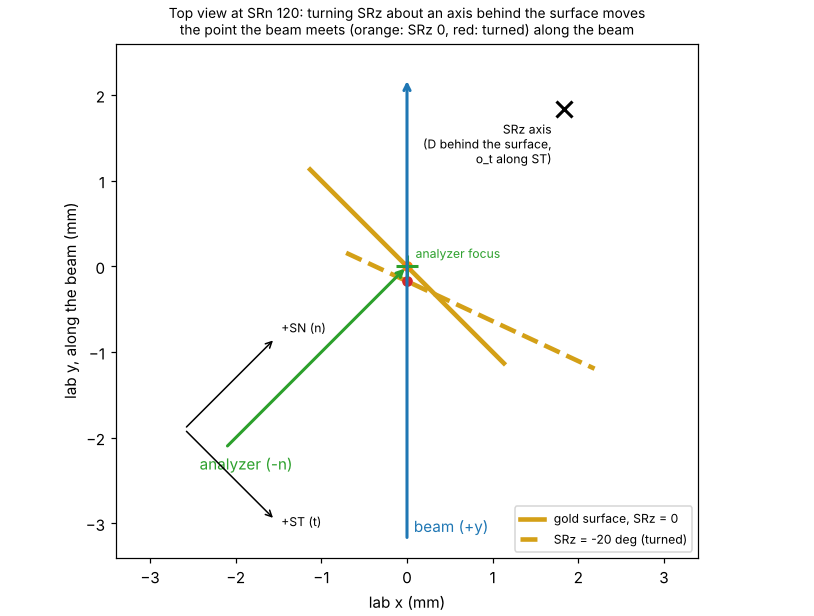

## Geometry: what an SZ line measures

At SRn 120, SRz 0, with the gold top at the analyzer focus, the beam meets the plate at

  u = ST0 − ST − d,  v = SZ0 − SZ,  d = SN − SN_gold

(the beam meets the surface at 45°, so a surface out of focus by d moves the point by d along −u).

**SRn (groups A and B).** SRn turns the plate about its normal, around the axis A = (A_u, A_v) on the plate. With
Δ = c − A (frame centre minus axis) and α = SRn − 120, the frame centre moves to A + R(α) Δ. At α = ±45° this moves the
diamond by Δ_u (cos α − 1) − Δ_v sin α horizontally and Δ_u sin α + Δ_v (cos α − 1) vertically. Two diamonds
(+45°, −45°) give both components of the axis, and the frame's rotation comes out with them.

**SRz (group C).** SRz turns the stage about a vertical axis. Its offset along ST (o_t, plate frame) and its depth D
behind the gold surface (D = h + `srz_offset_n`) set where the frame is found. With a = −SRz, Y = o_t − u_c and SN
kept, the ST that puts the frame centre on the beam moves by

  ST_c(a) − ST_c(0) = (D + Y)(cos a − 1) − (D − Y) sin a

which is about 1.4 mm at −25° for the present configuration (D ≈ 2.6 mm). The lines of group C are placed with the
newest configuration. How far the diamond really is from where they were placed is read on the diagonal edges, 1:1.

A tilt β of the gold face about the vertical changes the incidence. The frame then looks (cos β + sin β) times as
wide across the beam, which the SRz lines measure. The fit takes it up together with the ST scale.

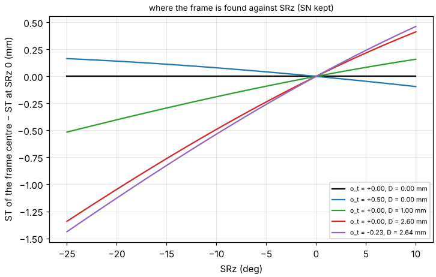

## The measurement plan

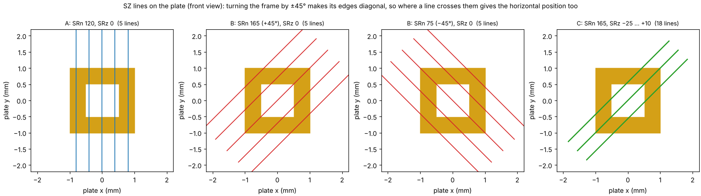

| group | SRn | SRz | lines | mainly gives |
|---|---|---|---|---|
| A | 120 | 0 | 5, ST ±0.8 mm around the centre | SZ0, rotation, SZ scale |
| B | 165 and 75 (±45°) | 0 | 5 each, ±1 mm across the diamond | ST0, SRn axis, ST scale |
| C | 165 | −25, −18, −11, −4, +3, +10 | 3 each, ±0.4 mm | SRz axis (offset along ST, depth), tilt of the gold face |

Every line: SZ ±2.2 mm around the frame centre, fly scan, step 0.02 mm. SN is set once per SRn / SRz setting so that
the frame centre is at the analyzer focus; between the lines of a setting only ST moves (a few tenths of a mm).

The natural way to record the lines is one file per setting, with ST stepped over the setting's lines and SZ fast.
Single-line files work as well.

*Measurement plan…* in the program lists every line (SRn, SRz, ST, SN, SZ from / to), checks it against the motor
ranges and the anti-collision model, and writes it as CSV. The lines only need to be within a few tenths of a mm of
the frame: the diamond is 2.8 mm across.

<!-- EFFORT TABLE -->
| | SZ lines | ST scanned | ST moves between lines | SRn settings | SRz settings |
|---|---|---|---|---|---|
| three maps (old, ST × SRz map 3) | 262 | 252 mm | 237 | 61 | 36 |
| SZ-line survey (new) | 33 | 0 | 33 (21 mm) | 4 | 6 |
<!-- /EFFORT TABLE -->

The ST scan of the old map 3 alone was about 250 mm of ST travel, against about 20 mm of ST moves here. SRn needs
4 settings instead of 61 (120, 165, 75, then back to 165 for group C), SRz 6 instead of 36.

Optional additions, all fitted with the rest:
- **An ST × SZ overview map** (SRn 120, SRz 0; coarse ST steps such as 0.1 mm are enough, SZ fast). It is the
  natural first step to find the frame, and gives the fit its start.
- **An SZ × SRn sweep** (SRn 60…180°): more SRn data, slow.
- **SN points at other SRz** (section 5).

## The global fit

All lines of all loaded files are fitted together: every gold edge of every line is predicted with the stage model
of QuickAlignment, and the constants are adjusted until the predicted edges fall on the measured ones.

- **Fitted:** ST0, SZ0, the SRn axis (x, y), the SRz axis offsets (along ST, depth), the in-plane rotation of the
  frame, the tilt of the gold face about v, and the ST and SZ scales.
- **From the settings:** SN_f = SN_gold − gold height. SN_gold is the SN with the gold top at the analyzer focus,
  from the SN scan.
- **Kept from the newest configuration** when the data cannot fix them, and said so:
  - no line with SRn turned: the SRn axis;
  - no line (or SN point) with SRz turned: the SRz axis and the tilt.
- **Start:** an overview map, if loaded, gives ST0, SZ0 and the rotation; otherwise a coarse search on ST0 / SZ0 with
  the SRz 0 lines. Then a coarse search on the SRz axis, then the full least squares.
- **Robust:** a line whose edges were read wrongly (part of the frame outside the line, a line grazing a corner of the
  hole) is left out and listed.
- **Optional SN points** (*SN at other SRz…*, a separate dialog). At a few SRz, an SN scan (ST following) on the
  frame's right bar gives the ST and SN at which the gold under the beam is at the analyzer focus. Each point is one
  more equation: how far the gold is from the analyzer focus along the beam, weighted with an uncertainty of 10 µm
  against 3 µm per edge. The points check the SRz axis as the analyzer sees it. They assume the beam passes through
  the analyzer focus (section 7). On their own they are weak for the depth (table, last row), so they complement the
  SRz lines rather than replace them.

## Perfect case and imperfect cases

All data simulated with the program, placed with the configuration drawn in magenta. The beam is traced through the
stage model of QuickAlignment, including the frame's walls and their shadows (the dark strip on one side of an edge
is the beam hitting a side wall) and Poisson noise. Left: the overview map. Right: every SZ line, grouped by SRn /
SRz. Magenta: the edges of the perfect frame. Cyan: the true edges.

**Perfect.** Frame at the plate centre, SRn axis through it, SRz axis in its surface:
- group A: the frame's horizontal edges at the same SZ on every line;
- group B: the diamond's chord lengths symmetric about the centre line;
- group C: the same diamond at every SRz.

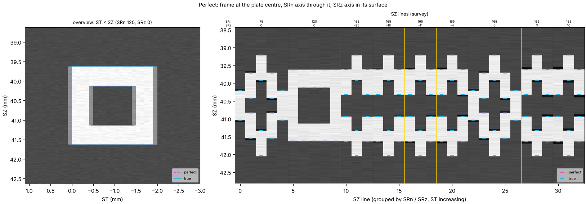

**Horizontal offset of the frame (0.3 mm along +u, 0.2 mm down).**
- The overview moves rigidly (ΔST = −0.3, ΔSZ = +0.2).
- Group A moves by +0.2 in SZ.
- In groups B and C the chords change: the lines pass elsewhere across the diamond. The diamond also moves because,
  for the SRn axis at the plate centre, the frame is now off-axis.

The fit cannot tell this offset from an offset of the whole plate. It goes into ST0/SZ0 and into the axes.

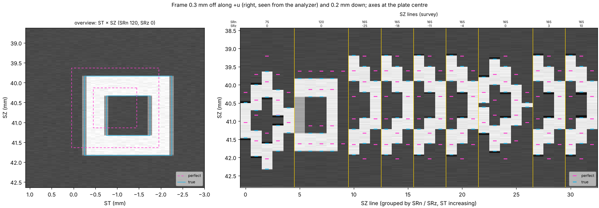

**SRn axis offset (0.4 mm, 0.3 mm from the frame centre).** Group A is unchanged. The diamonds at 165° and 75° move in
opposite directions (A + R(±45°) Δ).

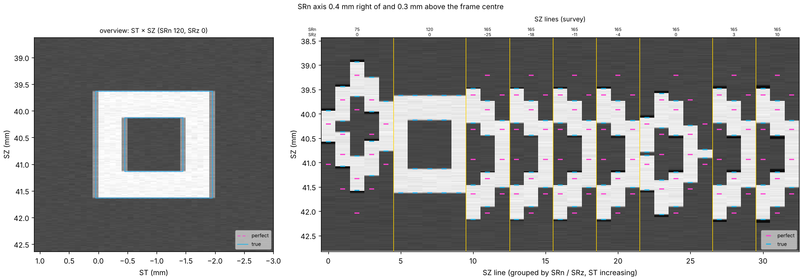

**SRz axis offset (0.5 mm along +ST, 1.0 mm behind the surface).** Groups A and B are unchanged. In group C the
diamond moves with SRz as in the formula of section 3.

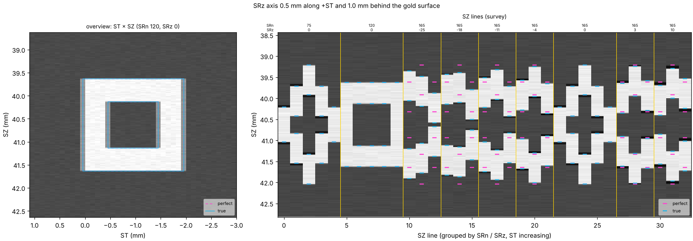

**The axes of the present configuration**, with the lines placed with it: every line crosses the diamond as planned.

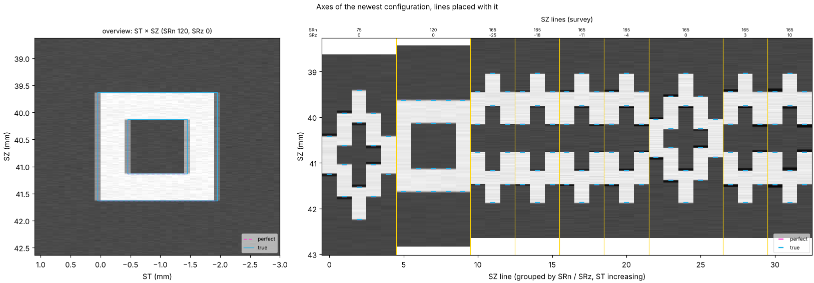

**In-plane rotation (3°) and tilt of the face (2° about v).**
- The rotation tilts the edges of the overview and makes the diamonds asymmetric.
- The tilt changes the diamond's width with SRz.

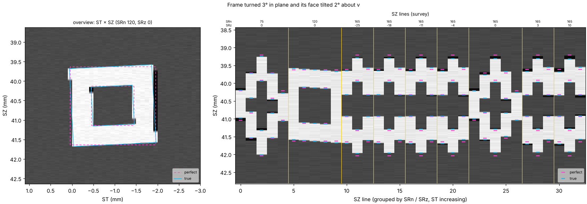

## Analyzer focus and beam position

**No correction is needed for the positions.** Every edge is where the *beam* crosses the gold edge. The analyzer
only weights the intensity, and a sharp edge stays where it is.

**The SZ lines do not slide along the beam.** SZ is vertical: it lies in the gold surface (up to a tilt about u) and is
parallel to the SRz axis, so along an SZ line the lit point keeps its place along the beam, at any SRn or SRz.

Between settings the frame centre stays at the analyzer focus, because SN is set per setting. The outer lines of
group C, ±0.4 mm from the centre, are at most about ±0.2 mm from the focus along the beam. With an analyzer
acceptance of 0.5 mm all lines keep their signal (table: 33/33 lines). The old map 3, an ST line at fixed SN, moved
the point by up to 1.7 mm along the beam and lost part of the frame.

**SN_f from an SN scan on the gold.** With ST following SN (ΔST = −ΔSN), the point stays on the beam and slides along
it. The intensity peak is SN_gold, and the peak width is the analyzer acceptance across its axis (here 0.29 mm).

**Beam beside the analyzer focus.** If the beam line passes a distance b beside the analyzer focus (horizontally,
across the beam), the SN scan peaks where the beam crosses the analyzer axis, √2 b further along that axis. SN_f
changes by √2 b (0.14 mm for b = 0.1 mm, table). All positions stay those of the beam, so ST0, SZ0 and the axes are
unchanged.

What remains: the found sample is √2 b from the true analyzer focus along the analyzer axis (lab y = b: the "beam"
column of the table). No stage constant can remove that; it is the beam alignment. A vertical offset only lowers the
intensity and goes into SZ0.

The optional SN points assume b = 0. With b ≠ 0 they carry the same offset at every SRz, which ST0 / SN_f mostly take
up.

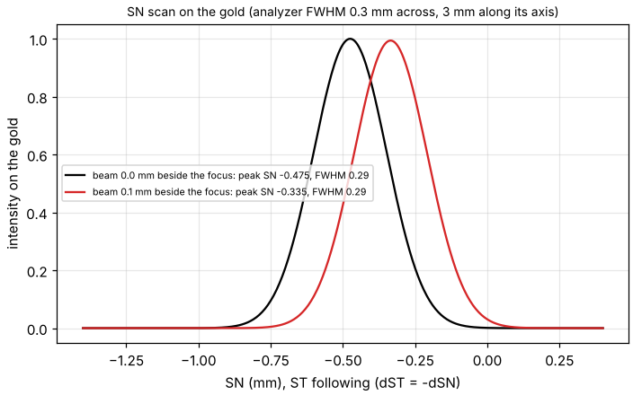

## Accuracy: simulated measurements fitted

Every case below was simulated on the axes of the present configuration, with SZ steps of 0.02 mm, Poisson noise at
3000 counts on gold, and the lines placed with a configuration 0.2–0.3 mm off. The data were then fitted by the
program as it fits measured files. The survey alone was used unless the case says otherwise.

Two kinds of numbers:
- **Error:** fitted minus true constant, after removing what the method cannot see (a frame shift goes into ST0, SZ0
  and the axes).
- **Test point:** where the fitted configuration really sends the beam on the true stage, for the plate point
  (1.5, 1.0) at SRn 100, SRz −15. "Plate" is the miss on the plate; "beam" is the distance from the analyzer focus
  along the beam.

<!-- RESULTS TABLE -->
Errors in µm (fitted − true).

| case | lines used | ST0 | SZ0 | SN_f | SRn axis x, y | SRz offset ST, SN (± σ) | test point: plate / beam |
|---|---|---|---|---|---|---|---|
| perfect frame | 33/33 | +1 | 0 | 0 | -1, 0 | +17 ± 11, +8 ± 9 | 2 / +5 |
| frame shifted (0.3, −0.2) mm, turned 3° | 48/54 | +2 | 0 | 0 | 0, 0 | +2 ± 7, 0 ± 6 | 360 / 0 |
| ST scale 1.02, SZ scale 0.99 | 33/33 | +2 | 0 | 0 | 0, 0 | +3 ± 12, -4 ± 10 | 35 / +14 |
| face tilted 2° about v, tilt not fitted | 33/33 | +6 | -1 | 0 | +5, 0 | -64 ± 56, 0 ± 45 | 8 / -21 |
| face tilted 2° about v, tilt fitted | 32/33 | +2 | 0 | 0 | 0, 0 | -5 ± 8, -8 ± 6 | 2 / -2 |
| analyzer acceptance 0.5 mm | 33/33 | +1 | 0 | 0 | -1, 0 | +13 ± 10, +7 ± 8 | 2 / +4 |
| beam 0.1 mm beside the analyzer focus | 33/33 | +4 | 0 | +140 | -1, 0 | -21 ± 12, -10 ± 9 | 0 / +90 |
| + overview map + SRn sweep, frame shifted / turned / tilted, analyzer 0.5 mm | 115/115 | 0 | 0 | 0 | -1, -1 | -4 ± 7, -6 ± 6 | 180 / -2 |
| no SRz lines: 6 SN points instead (5 µm noise) | 15/15 | +1 | 0 | 0 | -1, 0 | +32 ± 23, -146 ± 134 | 42 / +4 |
<!-- /RESULTS TABLE -->

Reading the table:
- **Mounting offset of the frame:** the fit is right for the frame, but every other sample is then off by that offset
  (0.36 mm here), as with any single reference feature.
- **ST / SZ scales:** they are measured (to ±0.001). QuickAlignment assumes 1, so a scale of 1.02 costs a few tens of
  µm away from the centre; the program says so.
- **Tilt:** ignoring it moves the SRz offset along ST by tens of µm; fitting it removes that.
- **Narrow analyzer:** nothing lost, since SZ lines do not slide along the beam.
- **Beam beside the focus:** SN_f takes up √2 b. The point is found on the beam, √2 b from the analyzer focus along
  the analyzer axis.
- **More data** (overview, SRn sweep): smaller uncertainties, the same values. The test point is off by the frame's
  mounting offset (0.18 mm in this case), as above.
- **SN points instead of SRz lines:** the SRz offset along ST comes out to a few tens of µm, but the depth only to about
  0.1 mm, because it enters through 1 − cos SRz (≤ 0.09). Measured together with the SRz lines, the SN points are a
  cross-check of the depth seen by the analyzer.

## Recommended protocol

1. SRn 120, SRz 0, PIX = PIY = 150. Find the gold (an **overview map**: ST × SZ, ±2 mm, ST steps 0.1 mm, SZ fast).
   Then run the **SN scan** (ST following) on a gold bar: SN_gold, and the analyzer acceptance from its width. Run
   the same scan on the riser for the gold height *h* (difference of the peaks). Focus the optic on the gold.
2. Open `GoldFrameCalibration.py`, set the gold height (and the frame's assumed place if not the centre), press
   *Measurement plan…*. Check that every line is "ok", and save the CSV.
3. Measure the lines of groups A, B and C. Per setting: set SRn, SRz and SN, then for each line set ST and scan SZ
   (fly, 0.02 mm), for example as one 2-D scan with ST stepped.
4. Optional: *SN at other SRz…*, *Fill the planned positions*. At each row run an SN scan (ST following) on the
   right bar and enter the ST and SN at the peak.
5. *Add files…* (all of them, the overview included), set SN gold, *Fit*. Check:
   - the edge rms: a few µm;
   - the lines left out: few, and only where the frame is not crossed or not seen;
   - the tilt: ≲ 2°;
   - the scales: within 0.5 % of 1;
   - the fitted edges on the data;
   - the change from the newest configuration.
6. *Save as new configuration*. As with InitialCalibration, try it on a sample of known position at another rotation
   (QuickAlignment, *Found here*).

## The program

**`GoldFrameCalibration.py`** (double-click; Windows: `GoldFrameCalibration.pyw`) opens the calibration window:

1. **Measurement plan…** The lines to measure, placed with the newest configuration of the chosen optic and the frame
   where it is taken to be. Each line is checked against the motor ranges and the anti-collision model. *Save as
   CSV…*.
2. **Add files…** Any number of `.nxs` files (or `.npz` from the simulator): one per setting, single lines, an
   overview map, an SZ × SRn sweep. The list shows SRn, SRz, ST, SN and the number of lines of each; *Remove* /
   *Clear*.
3. **Settings:**
   - SN gold (default: the SN of a file at SRn 120 / SRz 0);
   - gold height;
   - where the frame is taken to be on the plate, its outer size and hole;
   - fit the tilt, fit the scales;
   - divide by the diode;
   - the optic and its position at the gold focus (default: recorded in a file at SRn 120 / SRz 0, else the newest
     configuration's reference).
4. **SN at other SRz (optional)…** A separate dialog for the optional SN points:
   - *Fill the planned positions*: the rows to measure, with the expected SN;
   - enter the ST and SN at the peak;
   - load a CSV.

   Rows without a measured SN are not used. After a fit, each row shows how far its point is from the analyzer focus.
5. **Fit:**
   - *Results* tab: the seven constants with their uncertainty, the newest configuration and the change; the rotation,
     tilt and scales; per file the lines used and the rms; warnings.
   - *Data* tab: the overview and every SZ line with the fitted edges (orange).
6. **Save as new configuration** (with a comment): `configs/calibration_<time>_<optic>.json`, which QuickAlignment
   loads at its next start. The fit, the files and the SN points go into its `check` record.

*Load a simulated example* simulates the planned lines over a frame with known faults and loads them, with the true
values in the status bar, to try the window.

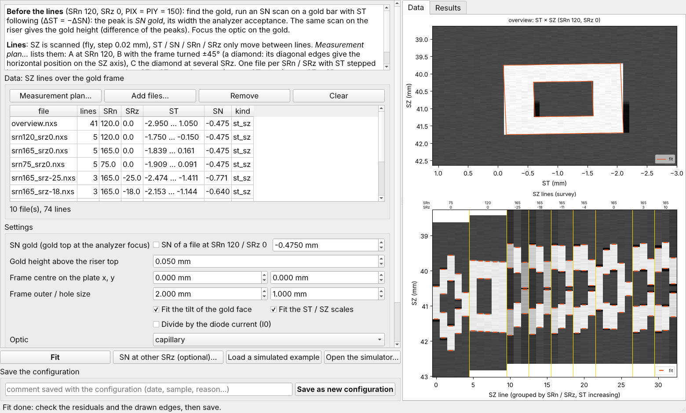

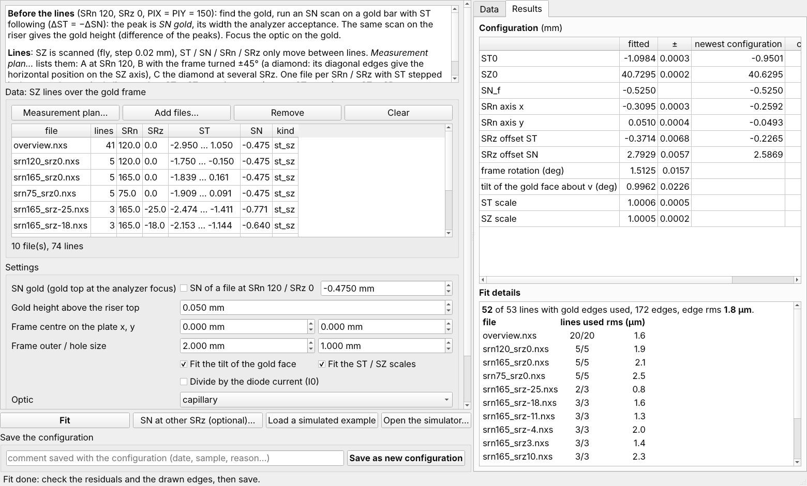

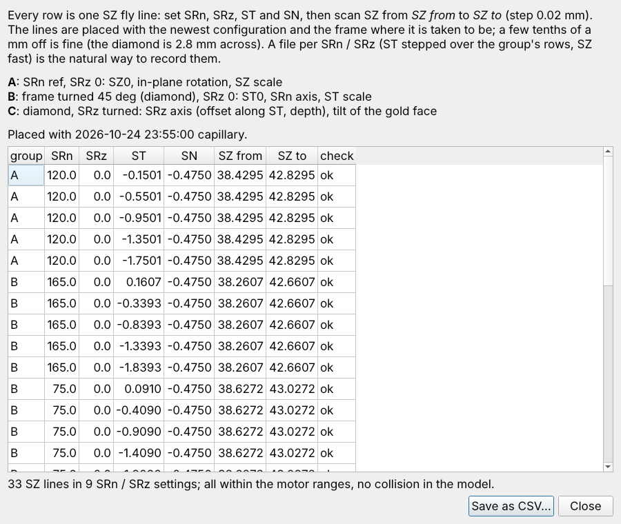

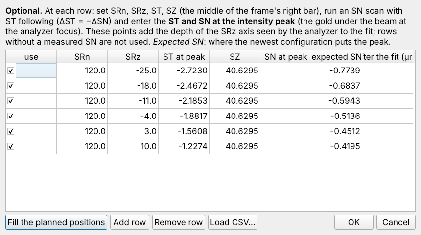

**`GoldFrameSimulator.py`** (double-click; `GoldFrameSimulator.pyw`; also *Open the simulator…* in the window) is the
interactive simulator. Sliders for:
- the frame: offset, rotation, tilts, height;
- the stage: SRn axis, SRz offsets, ST scale;
- the beam and analyzer: acceptance, beam offset.

It shows the overview map, the SZ lines of the plan, and on request the SZ × SRn sweep, with the edges of the perfect
frame (magenta).

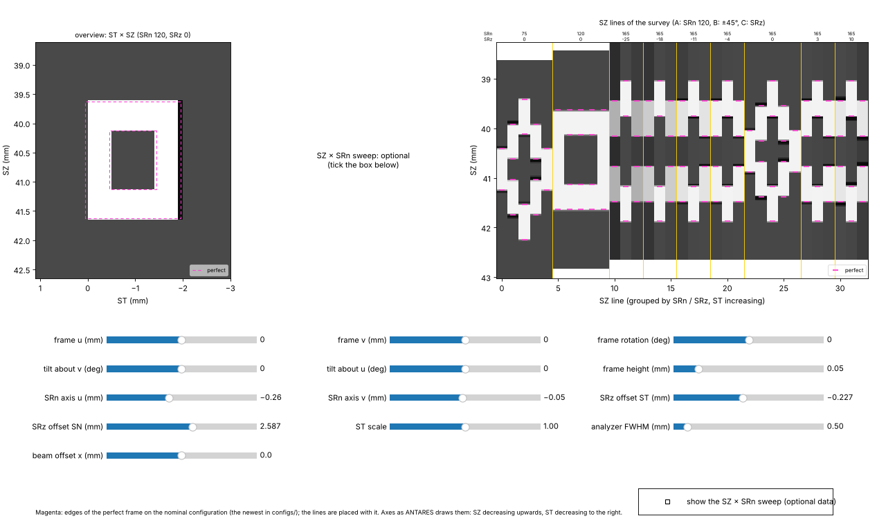

From a console:
- `python GoldFrameCalibration.py plan [--csv F]`: the plan.
- `python GoldFrameCalibration.py simulate [--frame-u … --srz-offset-n … --srn-sweep]`: a simulated measurement as
  ANTARES `.nxs` files, with the plan, a figure and the true values.
- `python GoldFrameCalibration.py fit FILE… [--sn-gold] [--sn-points CSV] [--height] [--no-tilt] [--no-scales]
  [--optic capillary|zone_plate] [--optic-position] [--plot PNG] [--save]`.

**Reading the files** (`quickalignment/spem_nxs.py`) follows a real SZ × SRn scan (`Cp_2023-05-28_22-08-47.nxs`):
- *Channels:* the `scan_data/data_NN` are recognised by their `long_name` (the NN numbers change between scan
  configurations).
- *Intensity:* `heason/total_int` (= vsum(mbsProj)); else `mbs/image32` (or `xproj`) summed per point.
- *Positions:* the motor readbacks of every point are fitted line by line, which takes up a fly-scan lag or a zig-zag.
  The fixed motors come from `ANTARES/i12-m-cx1-ex-sample-mt_*/position`.
- *Normalisation:* the diode (`dtc_diode`) on request.

ARPES viewer's own SPEM loader would take this layout for a deflector map, so the program reads the files itself.

## Limits

- **The frame is the plate reference.** Its mounting offset cannot be seen; it goes into ST0/SZ0 and the axes. To
  check it, measure a plate feature (riser edge) or a sample of known position.
- **SRn reference:** the frame's rotation and the SRn zero cannot be separated. QuickAlignment keeps SRn 120 = plate
  vertical, and the rotation found is reported.
- **ST / SZ scales** are measured and reported, not used by QuickAlignment.
- **Lines placed far off** (more than about 1 mm, e.g. after re-homing) may miss the diamond. Start from an overview
  map at SRn 120 and, if needed, a first fit with groups A and B only, then place group C again.
- **The simulator's intensities and analyzer acceptance** (Gaussian, 0.5 mm) are placeholders. The fit does not
  depend on them, only the simulated pictures do. Measure the acceptance with the SN scan.
- **The gold height *h*** shifts SN_f and `srz_offset_n` together. Measure it.
