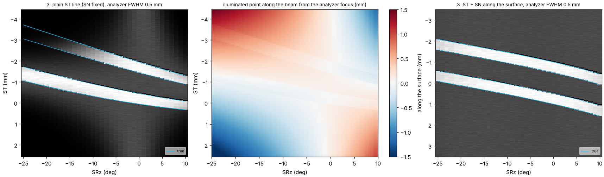

# Étalonnage par le cadre en or à partir de cartes d'intensité SPEM

Rapport sur la méthode proposée par l'équipe de la ligne : ST, SZ, SN, l'axe SRn et l'axe SRz à partir de trois
cartes d'intensité totale du cadre de référence en or. Simulations, réponses aux questions posées, et le programme qui
transforme les cartes mesurées en une configuration de QuickAlignment (`GoldFrameCalibration.py`).

## Sommaire

1. [En bref](#en-bref)
2. [L'échantillon et les trois cartes](#léchantillon-et-les-trois-cartes)
3. [Géométrie : ce que mesure chaque carte](#géométrie--ce-que-mesure-chaque-carte)
4. [Cas parfait et cas imparfaits](#cas-parfait-et-cas-imparfaits)
5. [L'étape 3 est-elle valable ?](#létape-3-est-elle-valable-)
6. [Foyer de l'analyseur et position du faisceau](#foyer-de-lanalyseur-et-position-du-faisceau)
7. [Précision : mesures simulées ajustées](#précision--mesures-simulées-ajustées)
8. [Protocole conseillé](#protocole-conseillé)
9. [Le programme](#le-programme)
10. [Limites](#limites)

## En bref

- **Les étapes 1 et 2 sont saines** et ne demandent aucune correction pour l'analyseur : SN fixé, une translation
  ST/SZ à SRz = 0 et une rotation SRn autour de la normale de la plaque laissent le point éclairé au même endroit le
  long du faisceau.
- **L'étape 3 est valable** : les bords du cadre, en fonction de SRz, donnent l'axe SRz (son décalage le long de ST et
  sa profondeur derrière la surface), à condition :
  1. D'ajuster ST0 de nouveau à l'étape 3. La profondeur n'intervient que par (1 − cos SRz), au plus 0,09 sur
     SRz −25…+10° : une erreur de 5 µm sur ST0 venant de l'étape 1 devient ~50 µm sur la profondeur.
  2. D'ajuster l'inclinaison de la face d'or autour de la verticale. Une inclinaison de 2° négligée déplace le
     décalage SRz le long de ST d'environ 0,09 mm ; la largeur du cadre en fonction de SRz la révèle.
  3. Que la plage en ST suive le cadre. Avec l'axe SRz 2,6 mm derrière la surface (configuration actuelle), le cadre
     se déplace d'environ 1,4 mm en ST entre SRz 0 et −25°.
- **Foyer de l'analyseur et position du faisceau :** chaque carte place les bords d'or là où le *faisceau* les
  traverse, quoi que voie l'analyseur ; les positions ajustées n'ont donc besoin d'aucune correction. Deux points
  comptent :
  1. À l'étape 3 avec SN fixé, le point éclairé glisse le long du faisceau pendant chaque ligne ST, jusqu'à environ
     1,5 mm ici. Avec une acceptance étroite de l'analyseur, une partie du cadre disparaît alors. Mieux : déplacer SN
     avec ST le long de la surface tournée (ΔSN = ΔST · tan(−SRz)), ou régler SN ligne par ligne.
  2. SN_f doit venir d'un balayage SN sur l'or (maximum d'intensité). Si le faisceau passe à côté du foyer de
     l'analyseur, ce maximum est là où le faisceau croise l'axe de l'analyseur, et SN_f le prend en compte
     (Δ = √2 × l'écart). Rien d'autre ne change.
- **Précision (simulation) :** quelques µm pour ST0, SZ0 et l'axe SRn, environ 10–20 µm pour l'axe SRz.
- **Limite de la méthode :** le cadre est pris pour le centre de la plaque. Toute erreur sur l'endroit où il est
  collé passe dans ST0, SZ0 et les axes, donc dans la position prévue de tous les autres échantillons.

## L'échantillon et les trois cartes

La référence : un cadre carré en or, 2 × 2 mm à l'extérieur avec un trou de 1 × 1 mm, collé en principe au centre de
la rehausse de la plaque standard. La colle peut le laisser décalé (u, v), tourné dans son plan, surélevé (or + colle
au-dessus du haut de la rehausse, *h*) et incliné. Seule l'intensité totale de photoémission sert
(`heason/total_int`, ou `image32` sommé) : l'or est clair, la rehausse en Ta et le fond du trou plus sombres.

| carte | balayé | fixé | donne |
|---|---|---|---|
| 1 | ST × SZ, environ ±2 mm | SRn 120, SRz 0, SN au foyer de l'or | centre du cadre (ST0, SZ0), rotation dans le plan, échelles ST / SZ, cisaillement |
| 2 | SZ (±2,5 mm) pour chaque SRn (120 ± 60°) | ST au centre du cadre | axe SRn (u, v) sur la plaque |
| 3 | ST (±3,5 mm) pour chaque SRz (−25…+10°) | SRn 120, SZ au centre du cadre (à travers le trou) | axe SRz : décalage le long de ST, profondeur derrière la surface (et ST0 à nouveau) |

Avant les cartes : un **balayage SN sur l'or** (ST suivant, ΔST = −ΔSN, pour que le point reste sur le faisceau)
donne SN_gold (maximum) et, par sa largeur, l'acceptance de l'analyseur (section 6). Puis focaliser l'optique à cet
endroit.

Coordonnées comme dans QuickAlignment. Repère plaque (u, v) : vue de face, languette en haut. Labo : origine = foyer de
l'analyseur, faisceau selon +y, +ST selon t = (1, −1, 0)/√2, +SN selon n = (1, 1, 0)/√2 (en s'éloignant de
l'analyseur). Les cartes sont dessinées comme ANTARES les dessine : ST décroissant vers la droite et SZ décroissant vers
le haut, donc droite = +u et haut = +v, la vue depuis l'analyseur.

## Géométrie : ce que mesure chaque carte

À SRn 120, SRz 0, avec le dessus de l'or au foyer de l'analyseur, le faisceau touche la plaque en

  u = ST0 − ST − d,  v = SZ0 − SZ,  d = SN − SN_gold

(le faisceau arrive à 45° : une surface défocalisée de d déplace le point de d selon −u).

**Carte 1.** Une image 1:1 du cadre (en miroir, comme les moteurs). Son centre donne ST0 et SZ0 ; ses largeurs les
échelles ST et SZ ; l'angle de ses bords la rotation dans le plan, et un angle différent pour les bords verticaux et
horizontaux est un cisaillement. Deux effets hors du plan apparaissent ici :
- Une face d'or inclinée de β autour de la verticale (v) fait paraître le cadre (cos β + sin β) fois plus large en ST.
  Une inclinaison de 2° se lit comme une « échelle ST » de 1,036 ; la carte 3 sépare les deux.
- Une inclinaison autour de l'horizontale (u) cisaille l'image.

**Carte 2.** SRn tourne la plaque autour de sa normale, autour de l'axe A = (A_u, A_v) sur la plaque. Avec
Δ = c − A (centre du cadre moins axe) et α = SRn − 120, le centre du cadre vu à ST fixé est à

  SZ_c(α) = SZ_c(0) − [Δ_u sin α + Δ_v (cos α − 1)]

et la ligne SZ passe à p(α) = Δ_u (cos α − 1) − Δ_v sin α du centre. Dans le cas parfait (A = c) la figure est
symétrique autour de SRn 120 ; les coins du cadre lui-même font les pointes à α = ±45°. Un décalage de l'axe fait
onduler les bandes (sin α : Δ_u, 1 − cos α : Δ_v) et rend la figure asymétrique (p(α) déplace les pointes et change
la largeur des bandes).

**Carte 3.** SRz tourne la platine autour d'un axe vertical. Son décalage le long de ST (o_t, repère plaque) et sa
profondeur D derrière la surface d'or (D = h + `srz_offset_n`) fixent où l'on trouve le cadre. Avec a = −SRz,
Y = o_t − u_c et SN fixé :

  ST_c(a) − ST_c(0) = (D + Y)(cos a − 1) − (D − Y) sin a

  largeur en ST = W (cos a + sin a) (W = 2 mm ou 1 mm ; une inclinaison β de la face ajoute β à a)

Le terme en sin a donne bien D − Y ; le terme en cos a − 1 (≤ 0,094 ici) donne D + Y environ dix fois moins
précisément.

## Cas parfait et cas imparfaits

Toutes les cartes sont simulées par le programme : le faisceau est suivi à travers le modèle de platine de
QuickAlignment, avec les parois du cadre et leurs ombres (la bande sombre du côté +u de chaque bord est le faisceau qui
frappe une paroi) et un bruit de Poisson. Tirets magenta : le cadre parfait sur la platine parfaite. Cyan : les vrais
bords.

**Parfait.** Cadre au centre de la plaque, axe SRn passant par lui, axe SRz dans sa surface :
- carte 1 : un carré centré sur (ST0, SZ0) ;
- carte 2 : symétrique autour de SRn 120 ;
- carte 3 : le cadre reste au même ST, seule sa largeur change.

**Décalage horizontal du cadre (0,3 mm selon +u, 0,2 mm vers le bas).**
- La carte 1 se déplace en bloc : ΔST = −0,3, ΔSZ = +0,2.
- La carte 2 change de forme : pour l'axe SRn (toujours au centre de la plaque) le cadre est désormais hors axe, son
  centre ondule avec SRn et la figure n'est plus symétrique.
- La carte 3 se déplace de −0,3 en ST et la trajectoire du cadre change de pente : Y = −0,3 entre dans les deux termes.

L'ajustement ne peut pas distinguer ce décalage de celui de toute la plaque : il passe dans ST0/SZ0 et dans les axes.

**Axe SRn décalé (0,4 mm, 0,3 mm du centre du cadre).** La carte 1 ne change pas. Dans la carte 2, les bandes suivent
SZ_c(α) ci-dessus et les pointes quittent ±45°.

**Axe SRz décalé (0,5 mm selon +ST, 1,0 mm derrière la surface).** La carte 1 ne change pas. Dans la carte 3, le
cadre dérive en ST avec SRz, comme dans la formule ci-dessus.

**Les axes de la configuration actuelle** (axe SRn (−0,26 ; −0,05), axe SRz 2,59 mm derrière le haut de la rehausse,
−0,23 mm le long de ST). Le cadre se déplace d'environ 1,4 mm en ST sur la plage de SRz : la plage ST de la carte 3
doit en tenir compte.

**Rotation dans le plan (3°) et inclinaison de la face (2° autour de v).**
- La carte 1 montre directement la rotation, et l'inclinaison comme une échelle ST de 1,036.
- La carte 2 est décalée en SRn par la rotation.
- Dans la carte 3, l'inclinaison change la largeur en fonction de SRz.

## L'étape 3 est-elle valable ?

Oui. Elle mesure l'axe SRz par rapport au faisceau, ce dont QuickAlignment a besoin. Dans les simulations, ajustée
comme ci-dessous, elle donne l'axe à environ 10–20 µm (tableau de la section 7). Conditions :

1. **SRn ramené à 120**, exactement comme pour la carte 1 (même référence SRn), et SZ à travers le trou, pour que
   chaque ligne montre quatre bords.
2. **Ajuster ST0 avec l'axe SRz.** Dans une vraie carte ANTARES, l'axe intérieur est l'axe en fly scan : dans la
   carte 1 (SZ intérieur), ST est donc échantillonné point par point. Ses bords ne sont connus qu'à ± un demi-pas, le
   même pour chaque ligne ; avec des pas de 20 µm cela laisse une erreur de quelques µm sur ST0. L'étape 3
   l'amplifie environ 10 fois sur la profondeur, qui n'intervient que par 1 − cos a. Dans la carte 3, ST est l'axe
   rapide : ST0 y est ajusté (le programme le fait).
3. **Ajuster l'inclinaison de la face d'or autour de v.** La colle laisse facilement 1–2°. Non ajustée, une
   inclinaison de 2° biaise le décalage SRz le long de ST d'environ 0,09 mm. La largeur
   W (cos(a + β) + sin(a + β)) en fonction de SRz rend β mesurable. Le programme l'ajuste en gardant la largeur
   apparente de la carte 1, et sépare ainsi l'échelle du moteur ST de l'inclinaison.
4. **Plage ST :** le centre du cadre se déplace de (D + Y)(cos a − 1) − (D − Y) sin a, soit environ 1,4 mm à −25°
   pour D ≈ 2,6 mm. Prendre ±3,5 mm autour du centre, ou suivre le cadre ligne par ligne.
5. **Utiliser les bords, pas l'intensité.** L'analyseur pondère l'intensité (section suivante), mais un bord net
   reste en place. Les lignes où une partie du cadre manque (hors plage ou non vue) sont reconnues et écartées.

La hauteur de l'or *h* n'intervient que dans la conversion D → `srz_offset_n` = D − h, et dans SN_f = SN_gold − h.
La mesurer par les pics des balayages SN sur l'or et sur la rehausse.

## Foyer de l'analyseur et position du faisceau

**Étapes 1 et 2 : aucune correction.** SN fixé, une translation ST/SZ à SRz 0 et une rotation SRn laissent le point
éclairé au même endroit le long du faisceau. Sa distance au foyer de l'analyseur ne change pas : l'analyseur ne fait
que multiplier toute la carte.

**Étape 3 avec SN fixé : le point glisse le long du faisceau.** La surface tournée n'est plus parallèle à ST. Le long
d'une ligne ST, le point éclairé se déplace le long du faisceau de

  Δy = −√2 ΔST sin a / (cos a + sin a)

soit ±0,7 mm pour ΔST = ±1,5 mm à a = 25°, dont Δy/√2 en travers de l'axe de l'analyseur et Δy/√2 le long de celui-ci.
Sur toute la carte 3 ci-dessous (ST ±3,5 mm), il va de −1,7 à +1,5 mm. Avec une acceptance de l'analyseur de 0,5 mm
(FWHM, valeur provisoire : à mesurer, voir plus bas), une partie du cadre n'a alors plus de signal (à gauche).

Les bords qui restent sont toujours justes : l'ajustement écarte les lignes qui ont perdu un bord et trouve le même
axe. Pour garder tout le cadre visible :
- déplacer **SN avec ST le long de la surface tournée**, ΔSN = ΔST · tan(−SRz) (à droite) : deux moteurs sur l'axe
  rapide, ce que le format de fichier permet (`actuator_1_1`, `actuator_1_2`) ; ou
- faire **une ligne ST par SRz avec SN réglé** pour que le centre du cadre soit au foyer (le programme lit une série de
  fichiers de lignes).

La défocalisation du faisceau lui-même (±1 mm hors du foyer de l'optique) n'élargit la tache que de
2 NA Δy ≈ 10 µm.

**Faisceau à côté du foyer de l'analyseur.** Si la ligne du faisceau passe à une distance b du foyer de l'analyseur
(horizontalement, en travers du faisceau), le balayage SN sur l'or culmine là où le faisceau croise l'axe de
l'analyseur, √2 b plus loin le long de cet axe. SN_f change donc de √2 b (0,14 mm pour b = 0,1 mm, ci-dessous). Toutes
les positions restent celles du faisceau : ST, SZ et les axes ne changent pas (tableau, dernière ligne).

Ce qui reste : l'échantillon trouvé est sur le faisceau, là où celui-ci croise l'axe de l'analyseur, à √2 b du vrai
foyer de l'analyseur le long de cet axe (y labo = b : la colonne « faisceau » du tableau). Aucune constante de
platine ne peut l'éliminer : c'est l'alignement du faisceau. Un décalage vertical ne fait que baisser l'intensité et
passe dans SZ0.

La largeur du balayage SN (ici 0,29 mm) est l'acceptance de l'analyseur en travers de son axe. La mesurer une fois :
elle dit jusqu'où le point éclairé peut glisser à l'étape 3.

## Précision : mesures simulées ajustées

Chaque cas ci-dessous a été simulé (pixels de 20 µm, bruit de Poisson à 3000 coups sur l'or) sur les axes de la
configuration actuelle, puis ajusté par le programme comme il ajuste des cartes mesurées.

Deux sortes de nombres :
- **Écart :** constante ajustée moins vraie, après retrait de ce que la méthode ne peut pas voir (un décalage du
  cadre passe dans ST0, SZ0 et les axes).
- **Point test :** où la configuration ajustée envoie réellement le faisceau sur la vraie platine, pour le point
  (1,5 ; 1,0) de la plaque à SRn 100, SRz −15. « Plaque » est l'écart sur la plaque ; « faisceau » la distance au
  foyer de l'analyseur le long du faisceau.

<!-- RESULTS TABLE -->
Écarts en µm (ajusté − vrai).

| cas | lignes carte 3 | ST0 | SZ0 | SN_f | axe SRn u, v | décalage SRz ST, SN (± σ) | point test : plaque / faisceau |
|---|---|---|---|---|---|---|---|
| cadre parfait | 36/36 | 0 | 0 | 0 | +1, 0 | 0 ± 9, -10 ± 8 | 2 / -1 |
| cadre décalé (0,3 ; −0,2) mm, tourné de 3° | 36/36 | 0 | 0 | 0 | 0, 0 | -5 ± 4, -6 ± 3 | 360 / -2 |
| échelle ST 1,02, SZ 0,99 | 36/36 | 0 | 0 | 0 | +1, 0 | +3 ± 3, +2 ± 3 | 38 / +15 |
| face inclinée de 2° autour de v, inclinaison non ajustée | 36/36 | 0 | 0 | 0 | +8, -2 | -89 ± 19, -3 ± 15 | 17 / -27 |
| face inclinée de 2° autour de v, inclinaison ajustée | 36/36 | 0 | 0 | 0 | +8, -2 | -19 ± 15, -6 ± 11 | 4 / -6 |
| analyseur 0,5 mm, lignes ST simples | 23/36 | 0 | 0 | 0 | +1, 0 | +1 ± 30, -2 ± 30 | 1 / 0 |
| analyseur 0,5 mm, ST + SN le long de la surface | 36/36 | 0 | 0 | 0 | +1, 0 | +6 ± 11, -2 ± 8 | 2 / +2 |
| faisceau à 0,1 mm du foyer de l'analyseur | 30/36 | +2 | 0 | +140 | +5, 0 | +15 ± 9, +3 ± 6 | 2 / +102 |
<!-- /RESULTS TABLE -->

Lecture du tableau :
- **Décalage de collage du cadre :** l'ajustement est juste pour le cadre, mais tous les autres échantillons sont
  alors décalés d'autant (0,36 mm ici), comme avec toute référence unique.
- **Échelles ST / SZ :** QuickAlignment suppose 1, donc une échelle de 1,02 coûte quelques dizaines de µm loin du
  centre. Le programme donne les échelles.
- **Inclinaison :** l'ignorer déplace le décalage SRz le long de ST d'environ 0,09 mm ; l'ajuster en retire
  l'essentiel.
- **Analyseur étroit :** les lignes ST simples perdent une partie de la carte 3 mais donnent le même axe.
- **Faisceau à côté du foyer :** SN_f prend √2 b ; le point est trouvé sur le faisceau, à √2 b du foyer de
  l'analyseur le long de l'axe de l'analyseur.

## Protocole conseillé

1. SRn 120, SRz 0, PIX = PIY = 150. Trouver l'or, puis faire le **balayage SN** (ST suivant) sur une barre d'or :
   SN_gold, et l'acceptance de l'analyseur par sa largeur. Faire le même balayage sur la rehausse pour la hauteur de
   l'or *h* (différence des pics). Focaliser l'optique sur l'or.
2. **Carte 1 :** ST × SZ, ±2 mm autour du cadre, SN = SN_gold. SZ est l'axe rapide (comme d'habitude). Pas ST de
   10–20 µm (ST0 et l'échelle ST sont affinés par la carte 3).
3. **Carte 2 :** ST au centre du cadre de la carte 1, SZ ±2,5 mm (rapide, 10 µm), SRn 60…180° par pas de 2°.
4. **Carte 3 :** SRn 120, SZ au centre du cadre (à travers le trou), SRz −25…+10° par pas de 1°, ST ±3,5 mm
   (rapide, 10 µm). Au mieux avec SN suivant ST le long de la surface (ΔSN = ΔST · tan(−SRz)), ou SN réglé ligne par
   ligne. Avec SN fixé, cela marche encore si l'acceptance de l'analyseur est assez large (largeur du balayage SN
   ≳ 1 mm).
5. Ouvrir `GoldFrameCalibration.py`, charger les trois cartes, régler SN gold et la hauteur de l'or, appuyer sur
   *Fit*. Vérifier :
   - les résidus : quelques µm ;
   - les lignes écartées : seulement là où le cadre est perdu ;
   - l'inclinaison ajustée : ≲ 2° ;
   - le cisaillement : ≲ 0,5° ;
   - le changement par rapport à la configuration précédente.

   Puis `--save`.
6. Comme avec InitialCalibration : essayer la nouvelle configuration sur un échantillon de position connue à une
   autre rotation (QuickAlignment, *Found here*).

## Le programme

**`GoldFrameCalibration.py`** (double-clic ; Windows : `GoldFrameCalibration.pyw`) ouvre la fenêtre d'étalonnage :

1. **Charger** les trois cartes (*Load…*) : un fichier `.nxs` 2-D, ou plusieurs fichiers de lignes (un par SRn / SRz)
   sélectionnés ensemble. Les cartes 2 et 3 sont facultatives ; un axe sans sa carte est gardé de la configuration la
   plus récente. Sous chaque carte : ce qui a été lu (type, taille, plages, moteurs fixes, canal d'intensité, position
   de l'optique).
2. **Réglages :**
   - SN gold (par défaut : le SN de la carte 1) ;
   - hauteur de l'or ;
   - où le cadre est supposé être sur la plaque (par défaut le centre), sa taille extérieure et celle du trou ;
   - ajuster l'inclinaison de la face d'or ;
   - diviser par la diode ;
   - l'optique et sa position au foyer de l'or (par défaut : le canal zone plate de la carte 1, sinon la référence de
     la configuration la plus récente).
3. **Fit (ajuster) :**
   - onglet *Results* : les sept constantes avec leur incertitude, la configuration la plus récente et le changement ;
     le détail de chaque carte (rms, lignes utilisées et écartées, rotation, échelles, cisaillement, inclinaison) et
     les avertissements.
   - onglet *Maps* : les cartes avec les bords ajustés (orange).
4. **Save as new configuration (enregistrer)** (avec un commentaire) : `configs/calibration_<heure>_<optique>.json`,
   que QuickAlignment charge au démarrage suivant. Ce qui a été mesuré et ajusté (échelles, rotation, inclinaison,
   résidus, fichiers) va dans son enregistrement `check`.

*Load a simulated example* simule les trois cartes d'un cadre avec de petits défauts connus et les charge, avec les
vraies valeurs dans la barre d'état, pour essayer la fenêtre.

**`GoldFrameSimulator.py`** (double-clic ; `GoldFrameSimulator.pyw` ; aussi *Open the simulator…* dans la fenêtre)
est le simulateur interactif. Curseurs pour :
- le cadre : décalage, rotation, inclinaisons, hauteur ;
- la platine : axe SRn, décalages SRz, échelle ST ;
- le faisceau et l'analyseur : acceptance, décalage du faisceau ;
- un interrupteur pour l'étape 3 le long de la surface.

Les trois cartes sont dessinées avec les bords du cadre parfait (magenta).

En console, la même chose sans fenêtre :
- `python GoldFrameCalibration.py simulate [--frame-u … --srz-offset-n … --analyzer-fwhm-h … --surface]` : les trois
  cartes pour les défauts donnés, en fichiers ANTARES `.nxs` (ou `.npz` sans h5py), une figure et les vraies valeurs.
- `python GoldFrameCalibration.py fit --step1 F --step2 F… --step3 F… [--sn-gold] [--height] [--no-tilt]
  [--optic capillary|zone_plate] [--optic-position] [--plot PNG] [--save]`.

**Lecture des fichiers** (`quickalignment/spem_nxs.py`), écrite d'après un vrai balayage SZ × SRn
(`Cp_2023-05-28_22-08-47.nxs`) :
- *Canaux :* les `scan_data/data_NN` sont reconnus par leur `long_name` (les numéros NN changent d'une configuration
  de balayage à l'autre).
- *Intensité :* `heason/total_int` (= vsum(mbsProj)) ; sinon `mbs/image32` (ou `xproj`) sommé par point, une ligne à
  la fois.
- *Positions :* les relectures des moteurs en chaque point (`actuator_1_1`, (extérieur, intérieur)) sont ajustées
  ligne par ligne, ce qui absorbe un retard de fly scan ou un zig-zag. Les moteurs fixes viennent de
  `ANTARES/i12-m-cx1-ex-sample-mt_*/position`.
- *Normalisation :* `normalize` divise par la diode (`dtc_diode`).
- *Plusieurs moteurs* sur l'axe rapide (ST + SN) sont pris en charge, ainsi que des séries de fichiers de lignes 1-D,
  un par angle.

Le loader SPEM d'ARPES viewer prendrait ce format pour une carte en déflecteur : `scan_data/actuator_1_1` existe et
les groupes de trajectoire sont `actuator_1_2` / `actuator_2_20`, et non `actuator_*_1`. Le programme du cadre en or
lit donc les fichiers lui-même.

## Limites

- **Le cadre est la référence de la plaque.** Son décalage de collage ne se voit pas ; il passe dans ST0/SZ0 et les
  axes. Pour le vérifier, mesurer un repère de la plaque (bord de la rehausse) ou un échantillon de position connue.
- **Référence SRn :** la rotation du cadre et le zéro de SRn ne peuvent pas être séparés. QuickAlignment garde
  SRn 120 = plaque verticale, et la rotation trouvée est rapportée.
- **Les échelles ST / SZ et le cisaillement** sont rapportés, pas utilisés par QuickAlignment.
- **Les intensités du simulateur et l'acceptance de l'analyseur** (gaussienne, 0,5 mm) sont provisoires. L'ajustement
  n'en dépend pas, seules les images simulées en dépendent. Mesurer l'acceptance par le balayage SN.
- **La hauteur de l'or *h*** décale SN_f et `srz_offset_n` ensemble. La mesurer.
