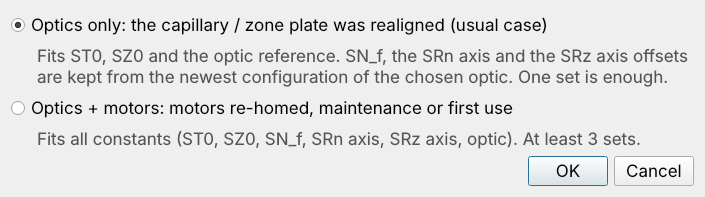
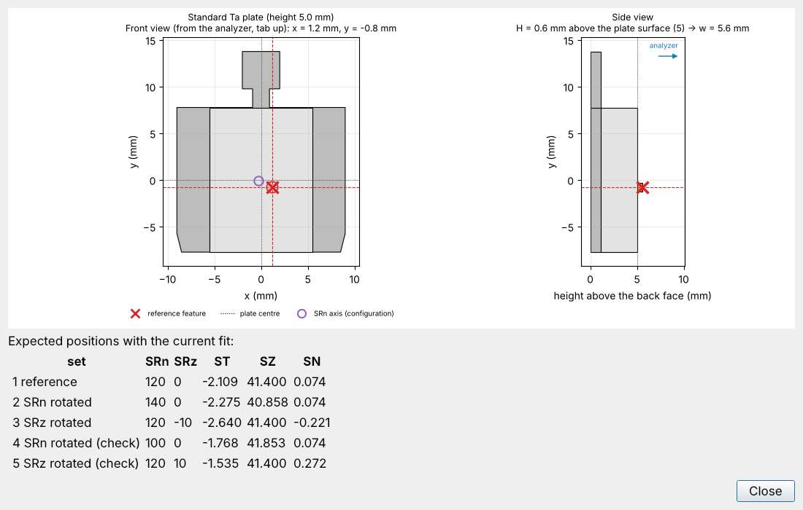
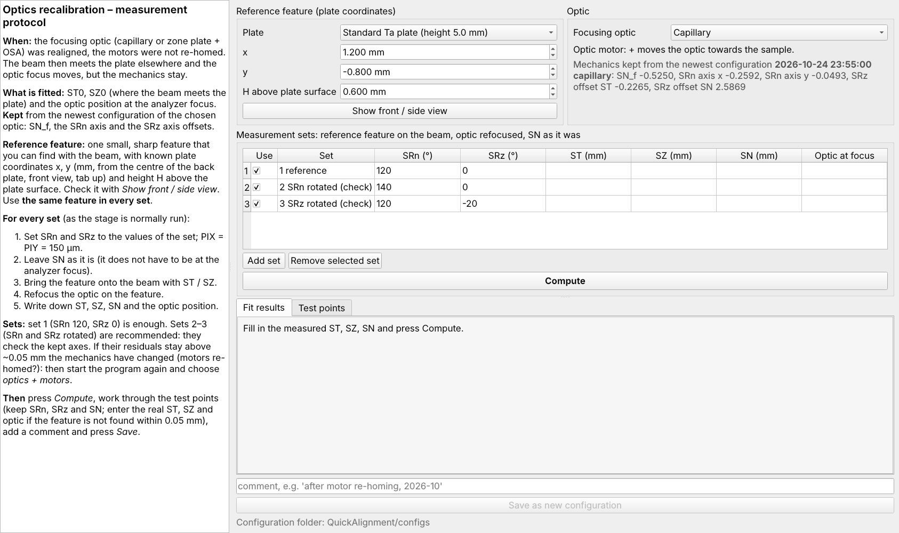
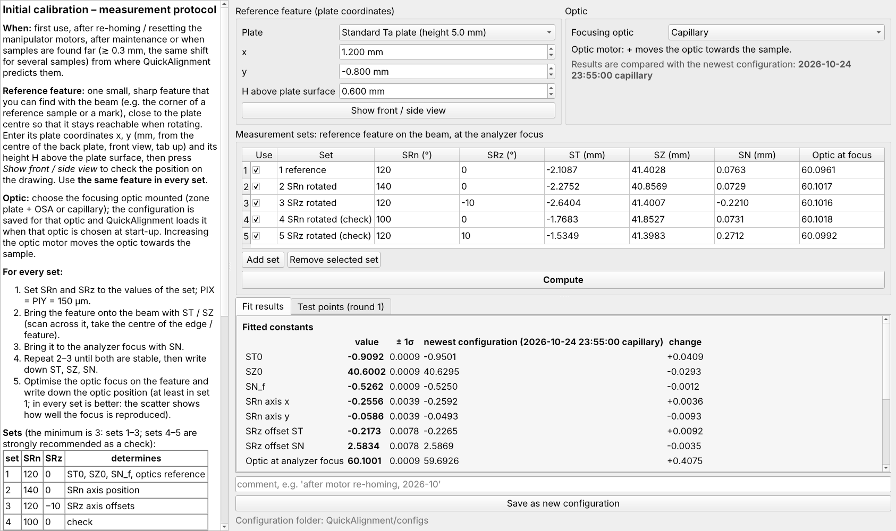
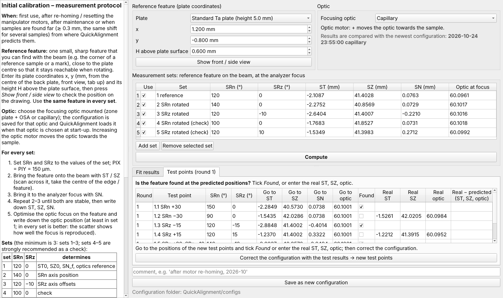

# QuickAlignment 线站人员指南

ANTARES 线站（SOLEIL）· 用 InitialCalibration 标定样品台模型，以及程序的维护

## 目录

1. [线站人员的职责](#线站人员的职责)
2. [样品台模型及其常数](#样品台模型及其常数)
3. [何时需要重新标定](#何时需要重新标定)
4. [启动 InitialCalibration](#启动-initialcalibration)
5. [仅光学（常见情况）](#仅光学常见情况)
6. [光学 + 电机（完整标定）](#光学--电机完整标定)
7. [测试点：检查与修正](#测试点检查与修正)
8. [保存，以及 QuickAlignment 如何使用该文件](#保存以及-quickalignment-如何使用该文件)
9. [程序维护](#程序维护)
10. [故障排查](#故障排查)

---

## 线站人员的职责

用户只 *读取* 样品台标定：QuickAlignment 载入所选聚焦元件的最新 **配置文件**，无法修改它。配置由线站人员用独立程序 **InitialCalibration** 生成，保存在 `configs/` 中：

```
configs/calibration_YYYY-MM-DD_HHMMSS_<optic>.json      optic: zone_plate 或 capillary
```

每次标定生成一个新文件，从不覆盖。用户剩下的误差（主要是在托上画样品的误差）由 Stage & Optics 页中的 *Found here* 修正。

## 样品台模型及其常数

从下到上：ST / SN / SZ 平移 → SRz → SRn → PIX / PIY 压电台 → 样品托。俯视：光沿 +y，分析器焦平面成 45°，ST 沿焦平面，SN 垂直于焦平面。

| 常数 | 含义 | 由哪组测量确定 |
|---|---|---|
| ST0, SZ0 | 使托中心位于光斑上的 ST / SZ（SRn 120°，SRz 0°） | 第 1 组 |
| SN_f | 使标准托凸台表面（5.0 mm）位于分析器焦平面的 SN | 第 1 组 |
| SRn 轴 x, y | SRn 转轴在托上的位置 | 转动 SRn 的一组 |
| SRz 偏移 ST, SN | SRz 轴相对托表面中线的偏移 | 转动 SRz 的一组 |
| 光学参考 | 使焦点位于分析器焦点的聚焦元件位置 | 各组中记录的元件位置 |

SRn = 120°（托竖直、tab 朝上）为机械参考；标定时 PIX = PIY = 150 µm。聚焦元件被建模为沿光束移动的焦点：ST、SZ、SRn 不改变表面平面，不需要移动元件；SN、SRz 和样品高度会改变（沿 SN 移动 1 mm，光斑沿光束移动 √2 mm）。

## 何时需要重新标定

| 情况 | 模式 |
|---|---|
| capillary 或 zone plate 重新准直（光打在托上的位置变了，焦点移动） | **仅光学** |
| 电机重新回零 / 复位、样品台维护、更换样品座 | **光学 + 电机** |
| 首次使用，或该元件还没有配置 | **光学 + 电机** |
| 用户 *Found here* 的修正超过约 0.3 mm，且多个样品偏移相同 | 先用仅光学检查；残差仍大则做完整标定 |

## 启动 InitialCalibration

双击 **`InitialCalibration.py`**（Windows：`InitialCalibration.pyw`）。第一个问题是重新标定了什么：



只有已存在配置时才提供 *仅光学*（机械参数取自该配置）。

两种模式下都先输入 **参考特征**：一个能用光斑找到的小而清晰的特征（参考样品的角、标记），靠近托中心，以便转动时仍可到达。输入它在托上的坐标 x、y（mm，从底板中心量起，正视、tab 朝上）和高出托面的高度 H，并选择 **聚焦元件**。**Show front / side view** 画出托和该特征，并列出用当前配置时各组应在何处找到它（检查电机行程）：



**每组都使用同一个特征**。

## 仅光学（常见情况）



拟合：ST0、SZ0 和光学参考。保留所选元件最新配置中的：SN_f、SRn 轴和 SRz 轴偏移。每组按平常运行样品台的方式测量：

1. 设定该组的 SRn 和 SRz；PIX = PIY = 150 µm。
2. **SN 保持不变**（不需要位于分析器焦点）。
3. 用 ST / SZ 把特征移到光斑上。
4. 在特征上重新聚焦。
5. 记下 ST、SZ、SN 和元件位置。

第 1 组（SRn 120°、SRz 0°）就够了。建议测第 2–3 组（转动 SRn 和 SRz），用来检查保留的转轴。如果它们的残差仍高于约 0.05 mm，说明机械已变化：重新启动程序并选择 *光学 + 电机*。

## 光学 + 电机（完整标定）

拟合全部 7 个常数和光学参考。每组都把特征放到 **分析器焦点** 处。

| 组 | SRn | SRz | 用途 |
|---|---|---|---|
| 1 | 120 | 0 | ST0、SZ0、SN_f、光学参考 |
| 2 | 140 | 0 | SRn 轴 |
| 3 | 120 | −10 | SRz 轴 |
| 4 | 100 | 0 | 检查（建议） |
| 5 | 120 | +10 | 检查（建议） |

**至少 3 组**（每组给出 ST、SZ、SN）；**建议 5 组**，这样错误的测量会在残差中显现。转角越大，转轴越精确（|SRn − 120| ≥ 20°，|SRz| 在几何允许范围内 ≥ 10°）。未测的组取消勾选；*Add set* 可添加其他角度的一组。

每组：

1. 设定 SRn 和 SRz；PIX = PIY = 150 µm。
2. 用 ST / SZ 把特征移到光斑上（扫过特征，取边缘或特征的中心）。
3. 用 SN 把它移到分析器焦点。
4. 重复 2–3 直到稳定；记下 ST、SZ、SN。
5. 在特征上优化聚焦并记下元件位置：至少在第 1 组，最好每组都记（+ 表示元件向样品移动）。

按 **Compute**：



- **拟合常数**，附 1σ 不确定度、最新配置中的值和变化量。
- 每组的 **残差**（模型 − 测量，mm），包括 ST、SZ、SN 和元件位置。5 组时应 ≲ 0.01–0.02 mm。单个残差大通常说明该组测在了别的点或没有聚焦：重测或取消勾选。
- 警告：*Not enough data*（哪些常数无法由现有各组确定）、*minimum data set*（无法发现错误）、残差高于 0.05 mm、未输入元件位置（光学参考未标定）。
- 对不可能的数值（输入错误、NaN）拟合时会报告问题，而不会保存。

## 测试点：检查与修正

*Compute* 之后，**Test points** 页预测未用于拟合的转角（SRn ± 30°、SRz ± 15°、SRn 与 SRz 组合）下，配置认为特征所在的 ST、SZ、SN 和元件位置：



每个测试点：

1. 移到预测的 SRn、SRz、ST、SZ、SN 和元件位置。
2. 如果特征在 **0.05 mm 以内** 位于光斑上并已聚焦，勾选 **Found**。
3. 否则：保持 SRn、SRz 和 SN，用 ST / SZ 把特征移到光斑上，聚焦，并输入 **实际的 ST、SZ 和元件位置**（元件可选）。红色的预测超出了某个电机的行程：修改该测试点的角度（会重新预测）。

**Correct the configuration with the test results → new test points** 把实际位置加入拟合（Found 的点只起确认作用），重新拟合全部常数，并预测新一轮测试点。已回答的轮次保留在表中（只读）并显示偏差。重复直到某一轮所有测试点都 Found，或偏差足够小；始终是离群值的那一组很可能测错了：取消勾选并重新修正。

## 保存，以及 QuickAlignment 如何使用该文件

添加注释（日期、原因、测量内容），按 **Save as new configuration**。文件以原子方式写入（写入失败不会留下不完整的文件），包含常数、光学参考、各组测量、测试点及其残差，以备查阅。

- QuickAlignment 每次启动时载入 **用户所选元件的最新文件**。zone plate 的配置不会取代 capillary 的配置，反之亦然。
- 如果该元件没有文件，则使用最新文件的样品台常数，并显示元件位置未标定。
- `configs/` 中损坏或无关的文件会被跳过。要撤回一个错误的配置，请把文件移出 `configs/`（不要修改文件）。
- 用户可以在 *Configuration…*（只读）中为自己的 session 选择较早的配置。

## 程序维护

**安装**（Python ≥ 3.9）：`pip install -r requirements.txt`（PyQt5 或 PySide6、numpy、matplotlib；测试需要 pytest）。用 `QuickAlignment.py` / `InitialCalibration.py` 启动（Windows 下 `.pyw` 不弹出控制台）。

**测试**：在 QuickAlignment 文件夹中运行 `python -m pytest`（约 120 个测试，约 15 s；Qt 在后台运行）。测试覆盖样品台模型、转动、标定拟合、文件读取和主窗口。

**可能需要修改的限值**（各在一处）：

| 内容 | 位置 |
|---|---|
| ST、SN、SZ 电机行程（输入框和警告） | `quickalignment/ui/stage_panel.py` 中的 `MOTOR_SPECS` |
| 可用 SRn / SRz、deflector 限值、允许偏差、光子能量范围、zone plate 能量、功函数 | `quickalignment/bz_target.py` 开头的常数 |
| 分析器狭缝方向以及狭缝 / deflector 角的符号 | `quickalignment/rotation.py` 中的 `AnalyzerGeometry` |
| 样品托图形（标准托、门电压托） | `quickalignment/geometry.py` |

**稳定性**：程序中出现意外错误时会在对话框中显示（含详细信息），程序继续运行，已输入的位置不会丢失；请收集这些详细信息。session 和配置以原子方式写入；无法读取的 session 会给出提示而不是崩溃；表格中不合理的输入（nan、inf、文字）会被拒绝。

**指南**：截图由 `python devtools/guide_screenshots.py` 生成，PDF 由 `python devtools/build_guides.py` 生成（需要 pandoc 和带 Chromium 的 Playwright）。源文件：`docs/USER_GUIDE_*.md`、`docs/STAFF_GUIDE_*.md`。

## 故障排查

| 现象 | 可能原因 / 处理 |
|---|---|
| 所有样品都偏移相同的量 | ST0 / SZ0 变了（元件重新准直）：*仅光学* |
| 偏移随转角变化 | 转轴变了（电机重新回零）：*光学 + 电机* |
| *仅光学* 第 2–3 组残差高于 0.05 mm | 机械已变化：*光学 + 电机* |
| 某一组残差很大 | 点不对、未聚焦或输入错误：重测或取消勾选 |
| *Not enough data: …* | 所列常数需要一组转动了 SRn 和 / 或 SRz 的测量 |
| 某组需要 SN 低于 −0.5 mm | 特征太低；改用更高样品上的特征 |
| QuickAlignment 显示 *default* 配置 | `configs/` 中没有任何可读的配置文件 |
