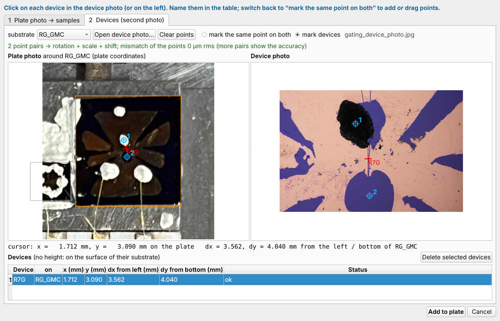
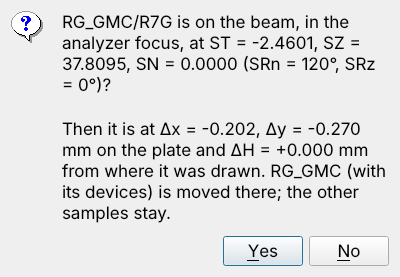
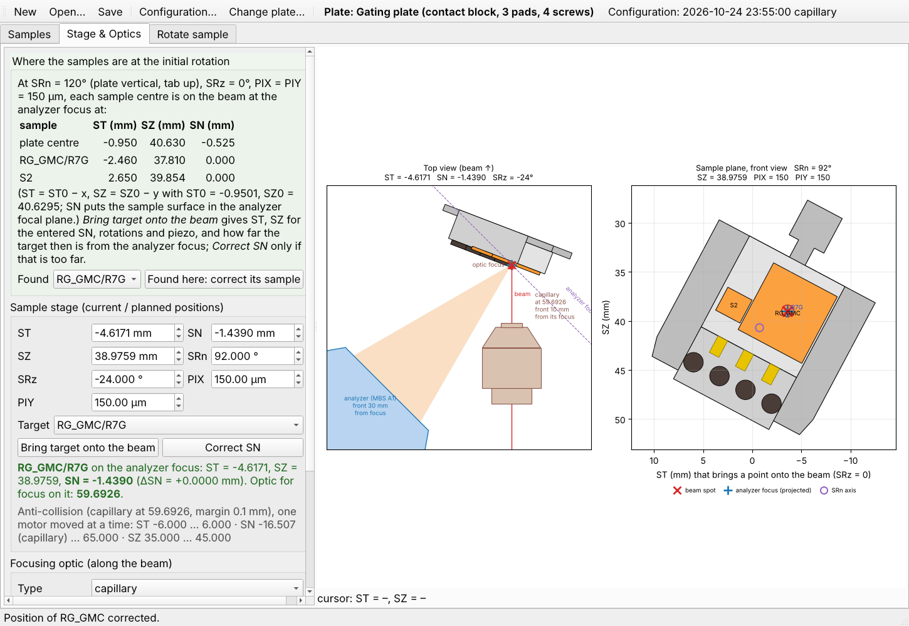
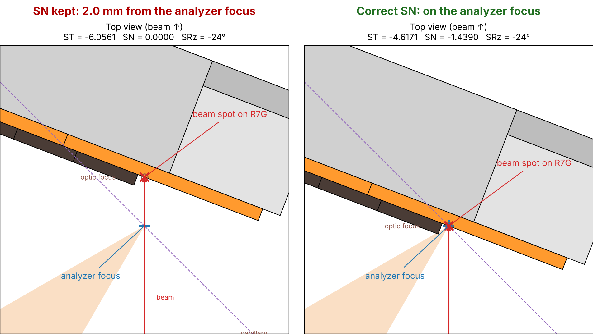

# QuickAlignment — User Guide

ANTARES beamline (SOLEIL) · finding samples on the plate, keeping them on the beam when rotating, and choosing the
rotation for a Brillouin-zone point

## Contents

1. [What QuickAlignment does](#what-quickalignment-does)
2. [Starting the program](#starting-the-program)
3. [Coordinates and motors](#coordinates-and-motors)
4. [Samples tab: drawing the plate](#samples-tab-drawing-the-plate)
5. [Stage & Optics tab: going to a sample](#stage--optics-tab-going-to-a-sample)
6. [Rotate sample tab: turning without losing the sample](#rotate-sample-tab-turning-without-losing-the-sample)
7. [Correct SN: putting the point back on the analyzer focus](#correct-sn-putting-the-point-back-on-the-analyzer-focus)
8. [Finding the angles for a Brillouin-zone point](#finding-the-angles-for-a-brillouin-zone-point)
9. [Sessions, plate and configuration](#sessions-plate-and-configuration)
10. [A typical beamtime](#a-typical-beamtime)
11. [Messages and what to do](#messages-and-what-to-do)

---

## What QuickAlignment does

On ANTARES the beam spot is at the micrometre scale or below, while the
sample plate is 18 × 15.5 mm. QuickAlignment turns the plate and sample geometry into **motor positions**:

- where each sample or device is at the start orientation (ST, SZ, SN at SRn = 120°, SRz = 0°);
- the ST / SN / SZ and the optic position that put a sample on the beam, in the analyzer focus;
- after a rotation (SRn, SRz), the positions that bring the same point back onto the beam;
- for a 2-D hexagonal crystal (graphene, WSe2, …), the SRn / SRz that bring Γ, K or M to the slit centre, and what to
  do when the stage cannot reach them.

The program never moves a motor. It computes numbers; you enter them on the beamline control system.

**The example of this guide.** All pictures follow one real case: a **gating plate** with the substrate **RG_GMC**
(Si, H = 0.525 mm) and its device **R7G**, measured with the **capillary** in October 2026. Its samples are found on a
phone photo of the plate, R7G on a microscope photo; R7G is brought onto the beam at the start orientation, its
position is corrected once found, and the plate is then turned to SRn = 92°, SRz = −24°, where R7G was found again
on the beamline at the predicted position.

## Starting the program

Install once: `pip install PyQt5 numpy matplotlib`. Then double-click **`QuickAlignment.py`** (Windows:
`QuickAlignment.pyw`, no console window), or run `python QuickAlignment.py [session.json]`.

At every start the program asks which **sample plate** is mounted and which **focusing optic** is used:

- **Standard Ta plate**: 18 × 15.5 mm back plate with an 11 mm wide raised part, 5.0 mm high.
- **Gating plate**: the same, with a contact block (3 gold pads, 4 screws); samples go only on the 11 × 10.5 mm above
  the block.
- **Custom plate**: the back plate with your own block (length, width, centre y and height from the back face).
- **Optic**: *zone plate + OSA* (95 eV only) or *capillary* (30–180 eV). The newest configuration made by the
  beamline staff for that optic is loaded (shown in the toolbar).

## Coordinates and motors

| name | meaning | range |
|---|---|---|
| x, y | position on the plate (mm), front view with the tab up, origin = centre of the back plate | – |
| H | sample height above the plate surface (mm) | – |
| ST | along the analyzer focal plane; ST < 0 moves the sample upper-left (top view) | −6 … 6 mm |
| SN | perpendicular to the analyzer focal plane; SN = 65 is the transfer position | −30 … 65 mm; below SN_f the limit is a collision (see *Anti-collision*) |
| SZ | vertical | 35 … 45 mm |
| SRn | azimuth about the sample normal; SRn = 120°: plate vertical, tab up | usable 60 … 180° |
| SRz | rotation about the vertical; SRz = 0: plate parallel to the analyzer focal plane | usable −25 … +10° |
| PIX, PIY | piezo stage, 0 … 300 µm, centre 150 µm | – |

At the start orientation a plate point (x, y) comes onto the beam at **ST = ST0 − x, SZ = SZ0 − y**, and a sample of
height H is in the analyzer focus at **SN = SN_f + H** (ST0, SZ0, SN_f come from the configuration). The motor fields
refuse values outside the travel ranges.

## Samples tab: drawing the plate

The picture shows the plate of the example after *From photo…* (next section): the substrate RG_GMC with its device
R7G (selected, blue marker), and a small chip S2. The red cross is the plate centre (x = y = 0); the grey frame is the
sample area (gating plate: 11 × 10.5 mm above the contact block).

- **Draw a sample**: drag on an empty part of the plate. **Move** it by dragging it, **resize** it by dragging an edge
  or corner (mouse positions are rounded to 0.1 mm). Or press *Add sample* and type the values.
- **Table**: name, x, y, length L, width W and height H can be typed exactly (typed values are not rounded).
  *Default H* is the height of new samples (0.525 mm: a standard Si wafer). *Type* says *sample*, or *substrate (n)*
  with the number of its devices.
- **Devices on a substrate**: select the substrate, press *Add device*, choose the two reference edges (*X ref*
  left/right, *Y ref* bottom/top) and the distances dx, dy to the device centre, or drag the blue marker. The table
  and the line under it also give the device position x, y on the plate. Devices move with their substrate. A
  substrate with devices is listed by its devices only in the target lists (e.g. *RG_GMC/R7G*).
- **Status**: `ok`, or what is wrong (outside the sample area, overlapping, device outside its substrate). Red items
  on the drawing have a problem.
- Wheel = zoom, middle drag = pan, right click = whole plate, Del = delete the selection (*Delete selected*). The
  line at the bottom gives the plate coordinates under the mouse.

### Samples from a photo

Instead of drawing, the samples can be found on a photo of the plate taken from straight above (sample side; a phone
photo is fine). Press **From photo…**:

1. *Open photo…*. The right view shows the plate model with the four corners of the sample area numbered **1–4**; the
   one to click next is **red**. Click that point on the photo, then the next red one (1 top left, 2 top right on the
   tab side, 3 bottom right, 4 bottom left; gating plate: 3 and 4 are where the sample area meets the contact block).
   Wheel = zoom (zoom in as far as needed to place the point), middle drag = pan, right click = whole photo; drag the
   markers afterwards to refine. *Clear points* starts again.
2. The photo is mapped onto the plate model (right view, blue outlines). Check that the outlines lie on the plate.
   The cursor shows plate coordinates (x, y in mm) in the right view and on the photo.
3. Samples are found by their colour (green boxes, magenta = what is taken):
   - *colour of picked samples* (default): click on a sample, on the photo or in the right view, to pick its colour
     (*Pick sample colour* for another kind of sample); only regions close to these colours are taken, silver paint
     and glue are left out.
   - *colour different from the bare plate*: everything on the plate, also silver paint and glue. If samples cover most
     of the sample area, *Pick bare plate colour* and click on bare plate.
   - *ΔE threshold*: the colour difference (CIELAB) that separates them; *min. size* drops dust; *border left out*
     ignores the edge of the sample area; *noise filter* fills small gaps (glare) and removes specks.
   - The swatches after *sample colours* are the picked colours; *Clear* forgets them. *show what is taken* switches
     the magenta overlay on and off; *photo opacity* fades the photo over the plate model.
4. Correct by hand. Every box in the list is added; *select* boxes by clicking them in the right view (Ctrl + click:
   several) or their rows, then: **Delete selected** (or Del) removes what is not a sample, **Merge selected** joins the
   pieces of a sample broken up by paint or wires. **Draw box** and drag in the right view adds a sample that was not
   found. These edits are kept when the threshold is changed; *Undo hand edits* forgets them. In the example the
   small chip on the left is broken up by its silver paint into five pieces: they are selected together and merged
   into S2 (ΔE "9 (merged)").
   **Names** are typed in the table (here S1 → RG_GMC); the *Devices* column counts the devices marked in tab 2.
5. Enter the **height H** (it cannot be seen from above; default: *Default H*), per sample in the table or with *Set H
   of all*.
6. Optionally locate the devices on a second photo (tab 2, below), then press **Add to plate**. *Remove the samples
   already on the plate* replaces the present ones.

The boxes are the bounding rectangles of what was found, in plate coordinates; they can then be moved, resized and
given devices like drawn samples. The accuracy is set by the corner clicks (about 0.1–0.3 mm); *Found here* in the
Stage & Optics tab corrects the rest. Everything runs on the computer, nothing is sent anywhere.

**Placing the corners well.** The corners are those of the **raised part** (riser top = sample area), not of the
wider back plate below it. A worn or rounded corner is placed where the two straight edges, extended, meet. Check in
the right view that the blue outline follows the riser edges and the back plate all round: if one corner is off, the
whole plate is distorted.

#### Tab 2: devices from a second photo

The plate photo shows where a substrate is, but usually not its devices; a closer photo (microscope, camera) shows the
devices but often not the substrate edges. The two photos are matched by points you mark on both:

1. Choose the **substrate** (or select its box in tab 1). The left view shows the plate photo around it, already in
   plate coordinates. **Open device photo…** (right view).
2. *mark the same point on both*: click a feature on the left that you also see on the device photo (a paint dot, a
   pattern corner, a scratch), then the same feature on the right; numbered markers, draggable. With 2 pairs the device
   photo is placed by rotation + scale + shift, with 3 by an affine map, with 4 or more by a perspective map. The line
   above the views gives the mismatch of the points (µm): with more pairs than needed it shows a wrong point. The
   substrate outline (orange) is drawn on the device photo as a check.
3. *mark devices*: click on each device in the device photo (or on the left). The table gives its plate position, its
   substrate and dx, dy from the left / bottom substrate edges; rename the devices there, delete wrong ones. Devices have
   no height: they are on the surface of their substrate.
4. Another device photo (for another substrate, or another part) can be opened: the devices already marked keep their
   positions. *Add to plate* adds each device to the sample it lies on (devices on no sample are left out).

In the example the device photo is a microscope picture of the centre of RG_GMC. Two features are seen on both
photos: point **1**, the silver paint dot above the centre (a black blob under the microscope), and point **2**, the
round hole of the electrode pattern (the purple disc). R7G is then clicked on the flake of the channel between them:
x = 1.712, y = 3.090 mm. With only two pairs the mismatch is always 0 µm; a third pair, when one is visible, checks
the match.

The accuracy is that of the plate photo (corner clicks, 0.1–0.3 mm) plus the point matching.

When all samples are drawn, press **Samples placed → Stage**.

## Stage & Optics tab: going to a sample

The green box lists, for every sample and device, the **ST / SZ / SN at the start orientation** (SRn = 120°,
SRz = 0°, PIX = PIY = 150 µm) that put its centre on the beam in the analyzer focus. In the example R7G is listed at
ST = −2.662, SZ = 37.540, SN = 0.000 (*plate centre* is the centre of the back plate, for reference).

1. Enter the current motor positions (absolute values, as on the control system). PIX, PIY are the piezo stage: the
   computations use them as entered (the start positions above are for the piezo centred).
2. Choose a **Target** and press **Bring target onto the beam**: ST and SZ are computed for the entered SN, SRn,
   SRz, PIX, PIY (**SN kept**, as the stage is usually run). The text below says how far the target then is from the
   analyzer focus along the beam (red above 50 µm: the spectra would be distorted) and the ΔSN that would remove it.
   Only if you judge it too far, press **Correct SN**: SN, ST, SZ that put the target on the analyzer focus (see
   [Correct SN](#correct-sn-putting-the-point-back-on-the-analyzer-focus)). If a motor would leave its range, or
   the plate would touch the optic or the analyzer, nothing is changed and you are told why. In the picture, R7G is
   brought onto the beam at SRn = 120°, SRz = 0°: with SN = 0 kept it is on the analyzer focus.
3. **Focusing optic**: *Type* is the optic in use (zone plate + OSA, or capillary); enter the optic position; press
   **Update schematic & optics**. The schematic shows the beam, the analyzer focus, the optic and the position
   **needed** for focus on the illuminated surface (in the picture the capillary is at 60.04, 59.6926 is needed).
   *Use required position* copies it into the field.
4. After focusing by hand, **Set as optics reference** takes the current state as the optics reference for this
   session.

**The schematic** (redrawn only with *Update schematic & optics*):

- *Top view* (beam going up): the plate with its samples (orange) seen from above, the beam (red line, × = beam spot
  on the surface), the analyzer nose (blue) with its acceptance cone (light orange) and its focus (blue +), the
  analyzer focal plane (dashed purple), the optic with its focus (○) and its position. Parts the plate would touch
  are red.
- *Sample plane, front view*: the plate as seen along the beam, turned by SRn; the axes give the ST, SZ that bring
  a point onto the beam at SRz = 0. × = beam spot, blue + = analyzer focus projected on the surface, purple ○ = SRn
  axis. Moving the mouse over it shows (under the views) those ST, SZ, the plate position x, y and the sample there.

### Found here: correcting the drawing

The photo (or the drawing) is good to 0.1–0.3 mm, so a device is usually found a little away from its listed
position. Once it is really **on the beam and in the analyzer focus**, enter the positions, choose the device under
*Found* and press **Found here: correct its sample**. The window asks for confirmation and gives the error of the
drawing (Δx, Δy on the plate, ΔH in height); *Yes* moves the sample with all its devices; the other samples stay.
All predictions then use the corrected position (saved with the session); the list of start positions is updated.

In the example R7G is found at ST = −2.4601, SZ = 37.8095, SN = 0 (SRn = 120°, SRz = 0°): it was drawn 0.20 mm too
far right and 0.27 mm too high. A correction above 0.3 mm, or the same shift for every sample, suggests that the
configuration is outdated: tell the beamline staff. Use *Found here* at SRz = 0° when you can: there SN kept means
"in the analyzer focus"; after an SRz turn with SN kept the point is usually not in the analyzer focus, and ΔH would
be wrong.

### Anti-collision

After *Update*, the line under the motors gives the **collision-free range** of ST, SN and SZ at the entered positions
(one motor moved, the others and the optic kept) and what sets each limit, e.g. *SN −4.1 (OSA) … 65*. The top view
draws the analyzer nose (MBS A1, 30 mm from the focus), the zone plate and OSA (thin plates; the OSA stays where it is
when the zone plate refocuses) or the capillary at scale, in red when the plate touches them. *Bring target onto the
beam*, *Correct SN* and the Rotate tab refuse a position where the plate would touch something. Lowering SN brings the
surface towards the optic and the analyzer: SN is limited from below only. ST and SZ are free for a plate parallel to
the focal plane, and limited when SRz tilts it or when something stands out (gating plate screws). The dimensions are
estimates kept in the configuration: if you know better, type the **working distances** (OSA, zone plate or
capillary front from the focus) in the fields under the optic position (for this session). Keep a safe distance and
watch the camera.

## Rotate sample tab: turning without losing the sample

1. **Current position**: the positions with the point of interest on the beam and in focus, and the optic position
   (*From Stage tab* copies them).
2. **Wanted angles**: the new SRn and SRz (or use *Find angles for a BZ point…*, next sections).
3. **Compute new position**: ST and SZ with the piezo centred and **SN kept**, and the optic position that refocuses
   (the table gives *now*, *new* and the change Δ). The point followed is the plate point under the beam at the
   current position (*Point:* line: what lies there and its plate x, y). The text says how far the point then is from the analyzer focus, *downstream* (further along the
   beam) or *upstream*, and how far it is now according to the model (red above 50 µm: the spectra would be
   distorted). SRn alone keeps the surface plane; SRz does not.
4. Only if the point is too far from the focus, tick **Correct SN** to see SN, ST, SZ and the optic position that
   put the point **on the analyzer focus** (every new computation starts unticked; see the next section). If a
   motor range does not allow it, the closest reachable position is given with its distance from the focus.
5. **Send to Stage & Optics tab** takes the shown solution (ticked: the corrected one), refused if it is out of range
   or the plate would touch something.

**Example.** R7G is on the beam at SRn = 120°, SRz = 0° (ST = −2.4601, SZ = 37.8095, SN = 0, capillary 59.6926);
wanted: SRn = 92°, SRz = −24°. With SN kept, ST = −6.0561, SZ = 38.9759 and the capillary at 61.7277 put R7G back on
the beam, but 2035 µm downstream of the analyzer focus (red), and ST is just outside its default range (−6 … 6):
*Out of range … use the corrected solution*. With *Correct SN*: ST = −4.6171, SZ = 38.9759, SN = −1.4390, the
capillary unchanged: R7G on the analyzer focus, all in range. *Send to Stage & Optics tab*:

The Stage tab now shows R7G **found again** at the new angles: in the sample plane view the plate is turned by
SRn = 92° (28° from the start orientation) and the beam spot (×) is on R7G, on the analyzer focus (+); the top view
shows the plate turned by SRz = −24°. *Bring target onto the beam* / *Correct SN* there give the same positions.

**Checked on the beamline**: at SRn = 92°, SRz = −24° with SN kept at 0, R7G was found at ST = −6.0479,
SZ = 38.9880, capillary 61.74, within 8 µm, 12 µm and 0.01 of the SN-kept prediction above. The stage reached
ST = −6.05 there: if your ST travel is larger than the default −6 … 6, enter it in *Configuration… → Motor limits*.

## Correct SN: putting the point back on the analyzer focus

The analyzer collects electrons from one fixed point in space, the **analyzer focus** (blue +; the analyzer focal
plane is the "SN = 0" line of the camera). The measured point has to be on the beam **and** at that point.

- **ST and SZ** move the plate across the beam: they bring the point onto the beam line. Where along the beam the
  point then is depends on **SN**, which moves the plate along its normal (at 45° to the beam).
- **SRn** turns the plate about its own normal: the surface stays in its plane, the point stays on the analyzer
  focus once ST, SZ follow it.
- **SRz** turns the plate about a vertical axis that does not pass through the surface (in the present configuration
  it lies about 2.6 mm behind the riser top). With ST, SZ following and **SN kept**, the point stays on the beam but
  slides **along** it, away from the analyzer focus. The optic is refocused onto the point, so the beam spot stays
  small; but the electrons now come from a point off the analyzer focus: energy and angle scales are distorted and
  the intensity drops. Above 50 µm the program writes it in red.
- **Correct SN** moves SN, with ST compensating (SN is not along the beam), so that the point is back **on** the
  analyzer focus. The optic then goes back to where it focuses on the analyzer focus.

In the example (left: SN kept, right: Correct SN, both at SRn = 92°, SRz = −24°) the beam spot on R7G is 2.0 mm
downstream of the analyzer focus with SN kept; SN = −1.439 with ST = −4.617 puts it back, the capillary at 59.6926
as before the turn.

SN is kept by default because the stage is run that way (the surface stays on the camera line, the optic is
refocused), and because *Correct SN* is absolute: it relies on the configuration's SN_f and rotation axes. Use it
when the distance is red, and check the anti-collision line: a lower SN brings the surface towards the optic and the
analyzer. In the Stage tab, *Correct SN* is a button (for the chosen target at the entered angles); in the Rotate
tab, a tick box.

## Finding the angles for a Brillouin-zone point

Under *Wanted angles*, **Find angles for a BZ point…** answers the question *"how much do I turn SRn and SRz so that
K is at the centre of the slit, the slit runs along Γ–K and the deflector stays near 0?"* for 2-D hexagonal crystals.

**What to enter** (read on the contour of a map in ARPES viewer; θ = deflector angle, contour x; φ = angle along the
slit, contour y):

1. **The map**: SRn and SRz at which it was measured (*From current position* takes them from the Rotate tab), its
   photon energy, the angles of **Γ** and of **one K or M point**.
2. **Crystal**: the in-plane lattice constant a (presets: graphene 2.46 Å, WSe2 3.282 Å, WS2, MoSe2, MoS2, hBN).
3. **Wanted**: the point (Γ, K or K′, only K, only K′, M), the **slit direction** (Γ–K, K–M, Γ–M, M–K), the photon
   energy of the new measurement, E − E_F of the point (e.g. −1.0 for the valence band top of WSe2 at K) and the work
   function (4.5 eV).

Press **Compute**. Below the inputs, *Γ–K on the map* compares the measured distance with the lattice constant (a
difference above 10 % means a wrong number, point or photon energy) and gives the tilt of the sample on the plate
(taken into account in the result).

**Result**: *Reachable* when, with the deflector at 0, the point is within |θ| ≤ 5° and |φ| ≤ 5° of the slit centre,
the slit within 2° of the wanted line, with SRn 60 … 180° and SRz −25 … +10°. The table lists every equivalent
point and both turning senses; the first row is the recommended one (SRz ≤ 0 first: the beam is then closer to the
surface normal and the spot smaller; then the smallest turn). *Beam to normal* is the incidence angle, 45° + SRz.

**Preview**: left, the map you will measure at the proposed angles (deflector across, slit angle up; the deflector
has gaps beyond ±8° and stops at ±12°; the green box is the accepted ±5°). Right, the 2-D zone in momentum,
oriented like your current map, with the current map (dashed) and the new analyzer window and slit (orange).

**Use these angles** writes SRn / SRz into *Wanted angles* and computes the new position. Set the deflector to 0
(and the photon energy, if it changed).

### When it cannot be reached

The manipulator has **no tilt axis**. A consequence: with a point at the slit centre and the deflector at 0, the
slit always runs along the line from Γ to that point (Γ–K for K). A slit *across* it (K–M, M–K) needs the deflector
at the emission angle of the point (15–20° at 95 eV), which the analyzer cannot do well:

The window then proposes the **radial alternative**: K at the centre with the slit along Γ–K; the deflector
direction then runs along K–M, so a short **deflector map** (|θ| ≤ 5°) gives the K–M cut through K with little
distortion. *Show the radial alternative* switches to it.

When the emission angle is too large for the SRz range, the window gives the **photon energies** at which the point
is reachable:

- ANTARES: 30–180 eV with the **capillary**; the **zone plate works at 95 eV only**. Changing the photon energy with
  the zone plate means changing to the capillary (realignment, capillary configuration).
- If SRn is the limit, the window says by how much to **turn the sample on the plate** when remounting it.
- If nothing works, the sample has to be remounted, or another, equivalent point chosen.

| example (E_F, work function 4.5 eV) | emission angle of K at 30 / 95 / 180 eV | K, slit along Γ–K |
|---|---|---|
| WSe2, a = 3.282 Å, Γ–K = 1.28 Å⁻¹ | 29.6° / 15.2° / 10.8° | reachable at 95 eV with SRz ≈ −15° |
| graphene, a = 2.46 Å, Γ–K = 1.70 Å⁻¹ | 41.2° / 20.4° / 14.5° | 95 eV: SRz ≈ −20°; 30 eV: not reachable (needs ≥ ~61 eV) |

The signs between the stage and the ARPES viewer contour have been checked once (deflector sign, 2026-09); on the
first use of a new kind of measurement, check that the point appears where the preview shows it.

## Sessions, plate and configuration

- **New / Open… / Save** (toolbar): a session holds the plate, the samples and devices (with their corrections) and
  the motor positions, in one JSON file. The first *Save* asks for the file name. Files are written safely: if
  saving fails (disk full, no permission), the previous file stays intact and a message tells you why.
- **Change plate…**: another plate; the samples are kept and misplaced ones are flagged.
- **Configuration…**: read-only view of the configuration in use (stage constants and optics reference), made by
  the beamline staff. An older configuration can be chosen for this session. Under *Motor limits* the min / max of
  ST, SZ, SN, SRn and SRz can be changed by hand (*Defaults* restores the built-in ones); *Apply limits* uses them for
  the input fields, the out-of-range and the anti-collision checks, and saves them in `configs/motor_limits.json`
  for the next starts.

## A typical beamtime

1. Start QuickAlignment, confirm plate and optic.
2. Find the samples on your mounting photo (*From photo…*), locate the devices on a microscope photo (tab 2), or draw
   them; or open the session prepared before the beamtime. Press *Samples placed → Stage*.
3. Go to the first sample or device with the listed ST / SZ / SN (SRn = 120°, SRz = 0°); find it with the beam
   (camera, photoemission map).
4. *Found here*: correct its position. The others now come out right too.
5. Measure a map at SRn = 120°, SRz = 0°; read Γ and one K / M point in ARPES viewer.
6. *Find angles for a BZ point…* → *Use these angles* → *Compute new position* (tick *Correct SN* if the point is
   more than 50 µm from the analyzer focus) → *Send to Stage & Optics tab*.
7. Save the session.

## Messages and what to do

| message | meaning / what to do |
|---|---|
| *Out of range: ST = … (range …)* | the point cannot be reached at these angles; choose other angles or use the corrected solution; if the stage really travels further, set the limits in *Configuration… → Motor limits* |
| *Collision: the plate would touch …* | at that position the plate (or a sample, a screw) would hit the optic or the analyzer; nothing is changed: choose another position, or move the optic back |
| *… in the analyzer acceptance cone: it would shadow the electrons* | the optic stands in the path of the electrons to the analyzer; move it out |
| *… µm from the analyzer focus* (red) | after an SRz turn the point left the focal plane: tick *Correct SN* |
| *Correct the sample position?* | *Found here*: check the positions and the device, *Yes* moves the sample |
| *Found here* moves a sample by > 0.3 mm | the drawing was off, or the configuration is outdated (motors re-homed): ask the staff |
| *The beam misses the plate* | ST / SZ do not put the beam on the plate |
| *Check the input: Γ–K on the map is …* | lattice constant, point or photon energy does not match the map |
| *An unexpected error occurred* | the program keeps running; check the last result, save the session and send the details to the staff |
