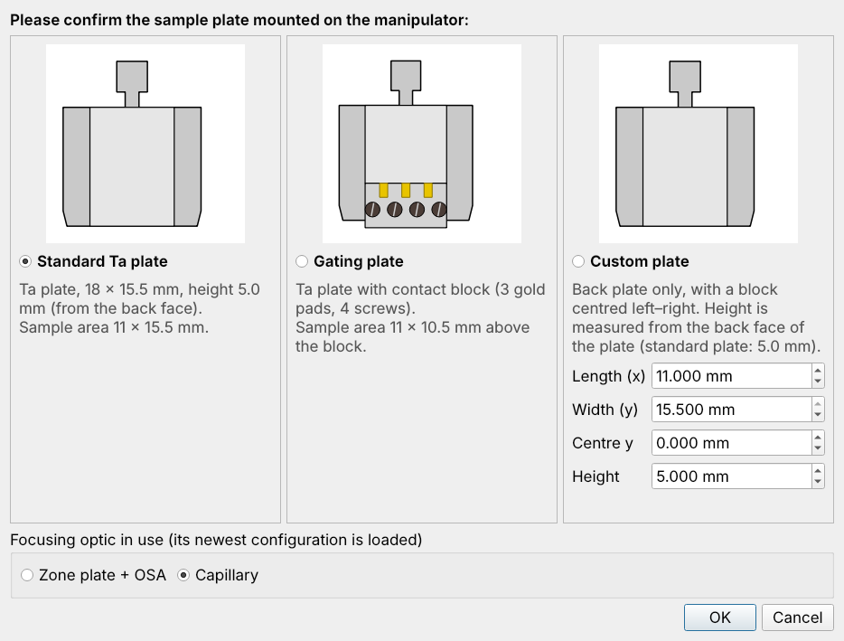
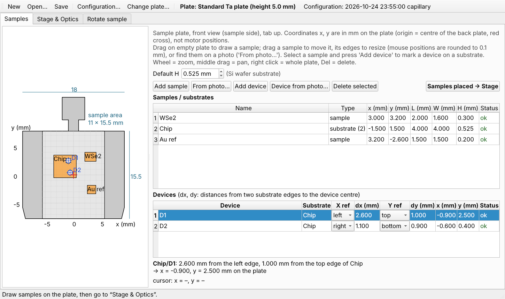
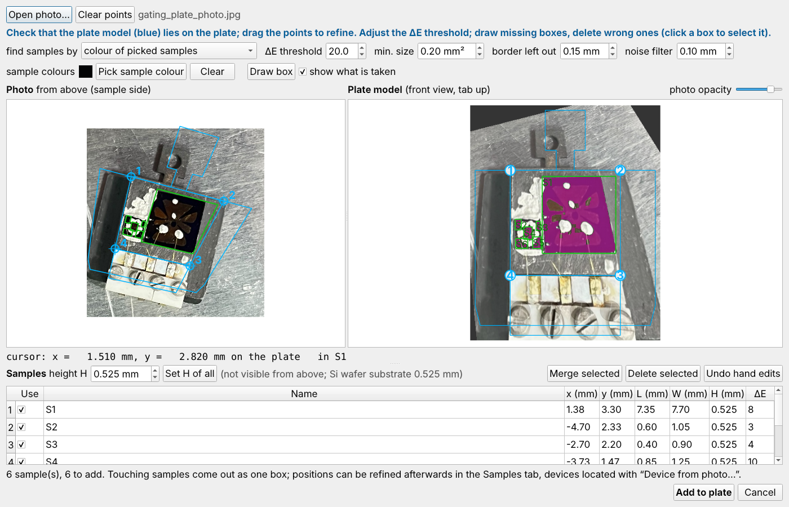
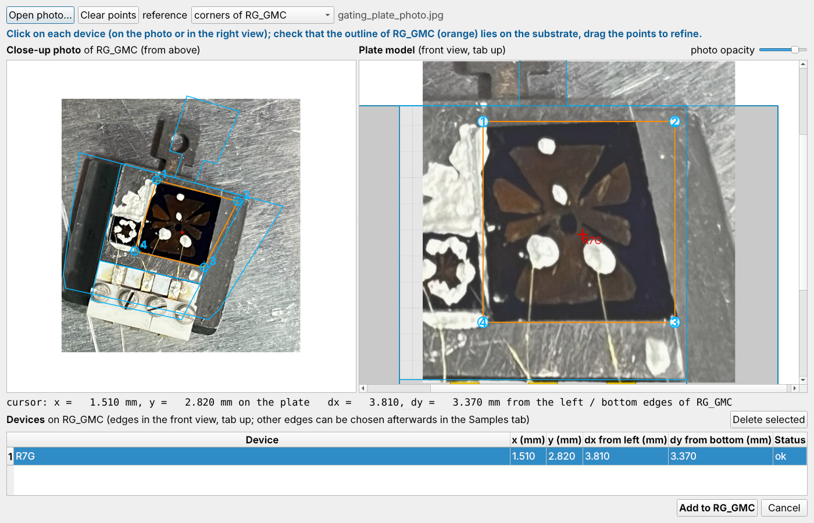
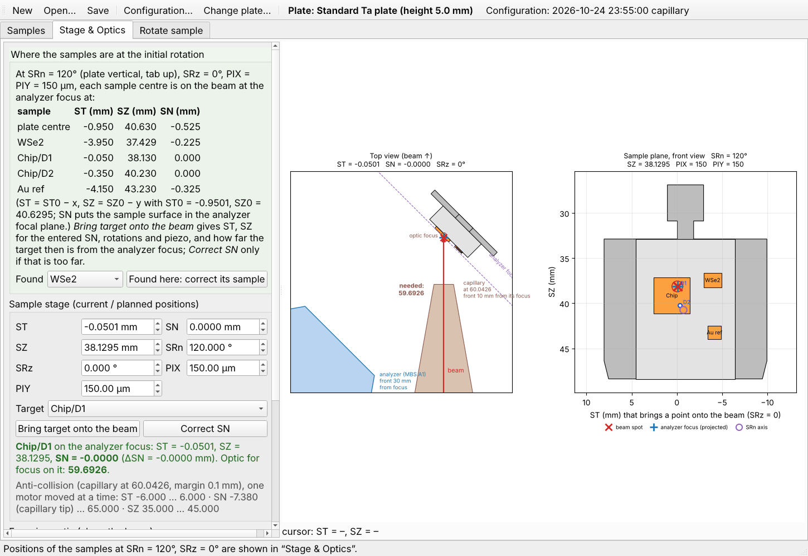
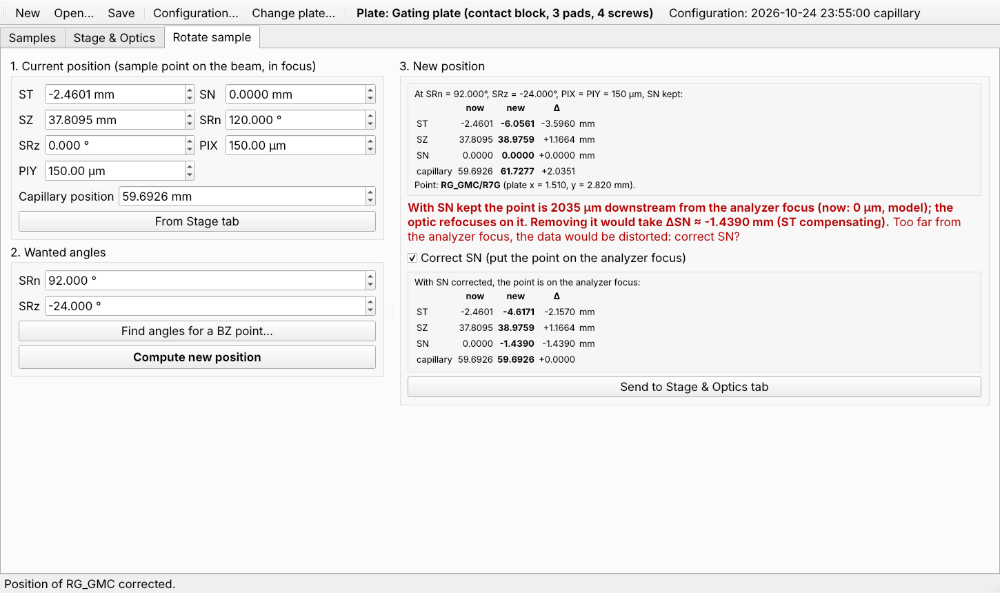
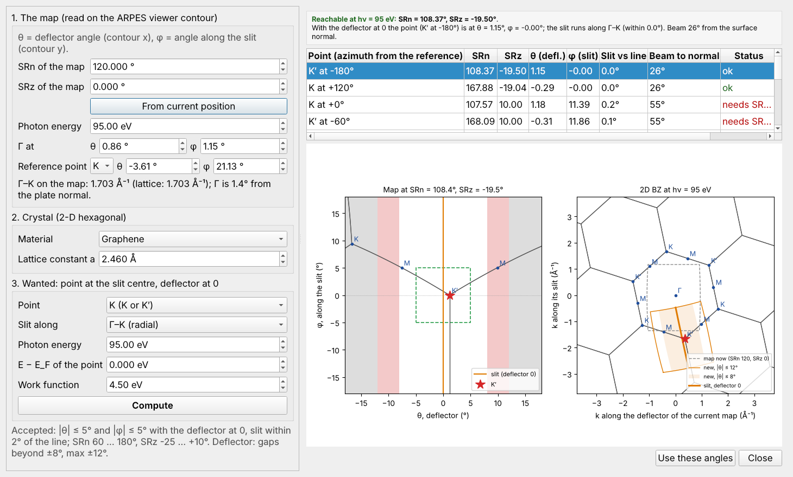
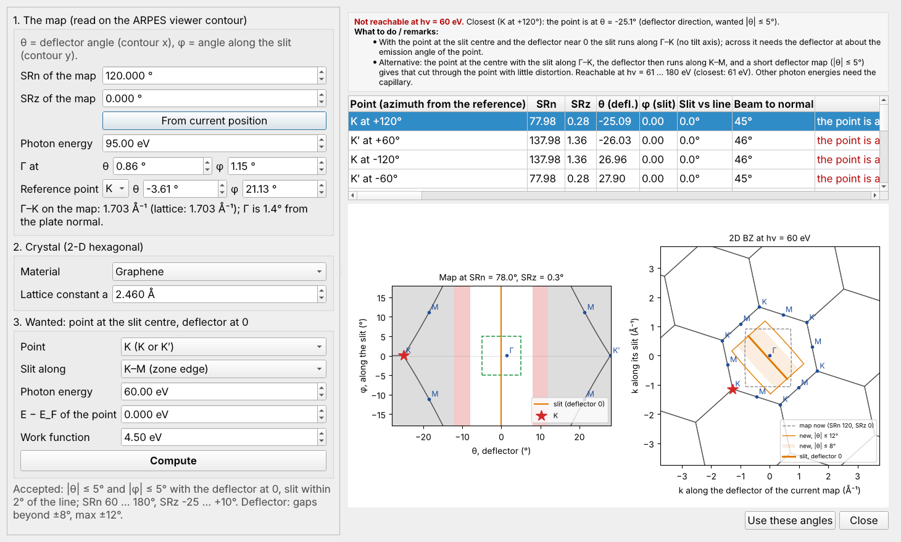
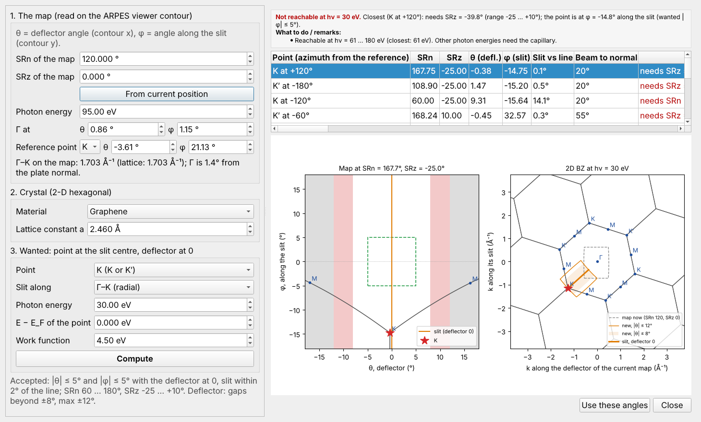
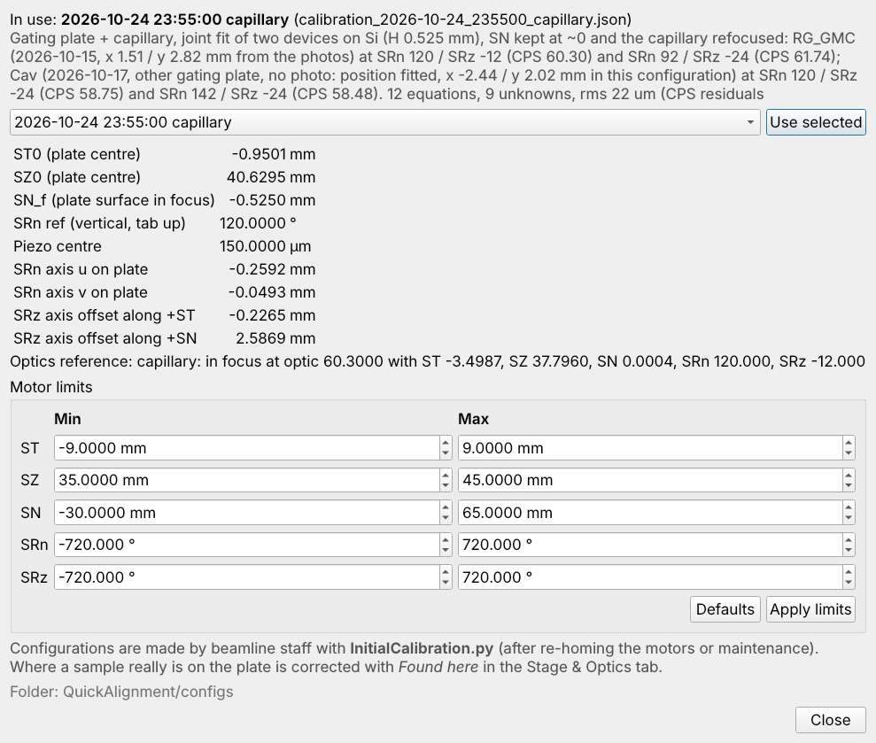

# QuickAlignment 用户指南

ANTARES 线站（SOLEIL）· 在样品托上找到样品、转动时保持样品在光斑上、为布里渊区高对称点选择转角

## 目录

1. [QuickAlignment 的用途](#quickalignment-的用途)
2. [启动程序](#启动程序)
3. [坐标与电机](#坐标与电机)
4. [Samples 页：绘制样品托](#samples-页绘制样品托)
5. [Stage & Optics 页：移动到样品](#stage--optics-页移动到样品)
6. [Rotate sample 页：转动而不丢失样品](#rotate-sample-页转动而不丢失样品)
7. [为布里渊区高对称点寻找转角](#为布里渊区高对称点寻找转角)
8. [Session、样品托与配置](#session样品托与配置)
9. [一次典型的机时流程](#一次典型的机时流程)
10. [提示信息与处理方法](#提示信息与处理方法)

---

## QuickAlignment 的用途

ANTARES 的光斑在微米量级或更小，而样品托有 18 × 15.5 mm。QuickAlignment 把样品托和样品的几何信息换算成
**电机位置**：

- 每个样品或 device 在初始取向（SRn = 120°，SRz = 0°）下的 ST、SZ、SN；
- 把样品放到光斑上、并位于分析器焦点处所需的 ST / SN / SZ 和聚焦元件位置；
- 转动（SRn、SRz）之后，让同一点回到光斑上的位置；
- 对二维六角晶体（graphene、WSe2 等），把 Γ、K 或 M 点移到狭缝中心所需的 SRn / SRz，以及达不到时的解决办法。

程序不会移动任何电机，它只给出数值，由你在线站控制系统里输入。

## 启动程序

首次安装：`pip install PyQt5 numpy matplotlib`。然后双击 **`QuickAlignment.py`**（Windows 下可用
`QuickAlignment.pyw`，不弹出控制台），或运行 `python QuickAlignment.py [session.json]`。

每次启动时程序会询问装的是哪种 **样品托**、用的是哪种 **聚焦元件**：

- **Standard Ta plate（标准 Ta 托）**：18 × 15.5 mm 底板，中间 11 mm 宽的凸台，高 5.0 mm。
- **Gating plate（门电压托）**：同上，下方有接触块（3 个金电极、4 颗螺丝）；样品只能放在接触块上方 11 × 10.5 mm 的区域。
- **Custom plate（自定义托）**：底板加自定义的块（长、宽、中心 y、从底板背面量起的高度）。
- **聚焦元件**：*zone plate + OSA*（只能用 95 eV）或 *capillary*（30–180 eV）。程序会载入线站人员为该元件做的最新配置（显示在工具栏中）。

## 坐标与电机

| 名称 | 含义 | 范围 |
|---|---|---|
| x, y | 样品托上的位置（mm），正视图、tab 朝上，原点 = 底板中心 | – |
| H | 样品高出托面的高度（mm） | – |
| ST | 沿分析器焦平面；ST < 0 时样品向左上移动（俯视） | −6 … 6 mm |
| SN | 垂直于分析器焦平面；SN = 65 为传样位置 | −0.5 … 65 mm |
| SZ | 竖直方向 | 35 … 45 mm |
| SRn | 绕样品法线的方位角；SRn = 120°：托竖直、tab 朝上 | 可用 60 … 180° |
| SRz | 绕竖直轴转动；SRz = 0：托平行于分析器焦平面 | 可用 −25 … +10° |
| PIX, PIY | 压电台，0 … 300 µm，中心 150 µm | – |

在初始取向下，托上一点 (x, y) 在 **ST = ST0 − x，SZ = SZ0 − y** 时位于光斑上；高度为 H 的样品在
**SN = SN_f + H** 时位于分析器焦点（ST0、SZ0、SN_f 来自配置文件）。电机输入框不接受超出行程的数值。

## Samples 页：绘制样品托

- **画样品**：在托的空白处拖动鼠标。拖动样品可 **移动**，拖动边或角可 **改变大小**（鼠标位置取整到 0.1 mm）。也可以按 *Add sample* 后直接输入数值。
- **表格**：名称、x、y、长 L、宽 W、高 H 都可以精确输入（输入值不取整）。*Default H* 是新样品的默认高度（0.525 mm：标准 Si 片）。
- **衬底上的 device**：选中衬底，按 *Add device*，选择两条参考边（left/right、bottom/top）以及到 device 中心的距离 dx、dy，也可以拖动蓝色标记。device 随衬底一起移动。带 device 的衬底在目标列表里只列出它的 device。
- **Status**：`ok`，或问题说明（超出样品区、重叠、device 不在衬底上）。图上红色的项目有问题。
- 滚轮 = 缩放，中键拖动 = 平移，右键 = 显示整个托，Del = 删除选中项。

### 从照片识别样品

除了手画，也可以从正上方（样品面）拍一张样品托照片（手机照片即可），让程序找出样品。按 **From photo…**：

1. *Open photo…*。右图的托模型上标出了样品区的四个角 **1–4**，下一个要点的点显示为 **红色**。在照片上点击这个点，然后点下一个红色的点（1 左上、2 右上（tab 一侧）、3 右下、4 左下；gating plate：3 和 4 是样品区与接触块相交处）。滚轮 = 缩放（可以放大到足够精确地选点），中键拖动 = 平移，右键 = 显示整张照片；之后可以拖动标记微调。*Clear points* 重新开始。
2. 照片被映射到托模型上（右图，蓝色轮廓）。检查轮廓是否和照片中的托重合。光标在右图和照片上都会显示托坐标（x、y，mm）。
3. 按颜色识别样品（绿色框；品红色 = 被识别的区域）：
   - *colour of picked samples*（默认）：在照片或右图中点一下样品来取色（其他种类的样品再按 *Pick sample colour* 取色）；只取与这些颜色接近的区域，银胶、胶水不会被算进去。
   - *colour different from the bare plate*：与裸托颜色不同的都算，银胶、胶水也会被算进去。如果样品盖住了大部分样品区，按 *Pick bare plate colour* 后在裸托上点一下。
   - *ΔE threshold*：区分两者的色差（CIELAB）；*min. size* 去掉灰尘；*border left out* 忽略样品区边缘。
4. 手动修正：按 **Draw box** 后在右图中拖动，添加没被找到的样品；点击一个框（或它的行）再按 **Delete selected**（或 Del）删除错误的框；被银胶或引线分成几块的样品，选中这些块（Ctrl + 点击）后按 **Merge selected** 合并。改变阈值后这些修改仍然保留；*Undo hand edits* 撤销全部手动修改。不需要添加的取消勾选。
5. 输入 **高度 H**（从上方看不出来；默认为 *Default H*），可以在表格中逐个修改，或用 *Set H of all*，然后按 **Add to plate**。勾选 *Remove the samples already on the plate* 会替换托上已有的样品。

框是识别区域在托坐标中的外接矩形；之后可以像手画的样品一样移动、改大小、添加 device。精度取决于四个角点得准不准（约 0.1–0.3 mm），剩下的误差由 Stage & Optics 页的 *Found here* 修正。全部在本机计算，不联网。

### 从近距离照片定位 device

整个托的照片往往只能看到衬底的轮廓。要定位上面的 device，先选中衬底，按 **Device from photo…**，再打开一张衬底的近距离照片（显微镜或相机，从上方拍）：

1. 按右图中红色数字的顺序，在照片上点击 **衬底的四个角**（同上）。如果照片拍的是整个样品区，选择 *reference: corners of the sample area*。
2. 检查衬底轮廓（橙色）是否与照片重合，然后点击每个 **device**（照片或右图中均可）。表格给出它在托上的位置，以及到衬底左边和下边的距离 dx、dy；光标也会显示这些值。可以在表格中改名、删除错误的点。
3. 按 **Add to …** 把它们加到衬底上（参考边之后可以在 Samples 页的 device 表格中更改）。

device 的位置是相对于衬底的：先画出或识别出衬底；以后修正衬底位置时 device 会跟着移动。

样品画完后，按 **Samples placed → Stage**。

## Stage & Optics 页：移动到样品

绿色框列出每个样品和 device 在 **初始取向**（SRn = 120°，SRz = 0°，PIX = PIY = 150 µm）下，使其中心位于光斑上且在分析器焦点处的 **ST / SZ / SN**。

1. 输入当前电机位置（绝对值，与控制系统一致）。
2. 选择 **Target**，按 **Bring target to focus**：按输入的 SRn、SRz、PIX、PIY 计算 ST、SN、SZ。若某个电机会超出行程，数值不会改变，并提示是哪一个。
3. **聚焦元件**：输入元件位置，按 **Update schematic & optics**。示意图显示光束、分析器焦点、聚焦元件，以及在被照表面上聚焦 **所需的** 位置。*Use required position* 把该位置填入输入框。
4. 手动聚焦后，**Set as optics reference** 把当前状态作为本次 session 的光学参考。
5. **Found here: correct its sample**：当某个 device 确实已在光斑上并已聚焦时，输入当前位置，选择该 device 并按此按钮。它所在的样品（连同所有 device）会在图上移动 Δx、Δy、ΔH，即绘图误差。之后所有预测都使用修正后的位置（随 session 保存）。修正量超过 0.3 mm 可能说明配置已过时：请告知线站人员。

示意图只在按 *Update schematic & optics* 时重画。鼠标移到样品平面视图上时，会显示把该点移到光斑上的 ST、SZ 以及该处是什么。

## Rotate sample 页：转动而不丢失样品

1. **Current position**：感兴趣的点位于光斑上且已聚焦时的位置及聚焦元件位置（*From Stage tab* 可直接复制）。
2. **Wanted angles**：新的 SRn 和 SRz（或使用 *Find angles for a BZ point…*，见下一节）。
3. **Compute new position**：在压电台居中、**SN 不变** 的情况下给出 ST、SZ，以及重新聚焦所需的元件位置。文字说明该点距离分析器焦点有多远（超过 50 µm 显示为红色：谱会畸变）。只转 SRn 时表面平面不变，转 SRz 时会改变。
4. 勾选 **Correct SN**，可看到把该点放到 **分析器焦点上** 所需的 SN、ST、SZ 和元件位置。若电机行程不允许，则给出最接近的可达位置及其与焦点的距离。
5. **Send to Stage & Optics tab** 采用所显示的结果（超出行程时拒绝）。

## 为布里渊区高对称点寻找转角

在 *Wanted angles* 下，**Find angles for a BZ point…** 针对二维六角晶体回答这个问题：*"SRn 和 SRz 要转多少，才能让 K 点位于狭缝中心、狭缝沿 Γ–K、且 deflector 接近 0？"*

**需要输入的内容**（在 ARPES viewer 中 map 的 contour 上读取；θ = deflector 角，contour 的 x；φ = 沿狭缝的角度，contour 的 y）：

1. **The map**：测这张 map 时的 SRn 和 SRz（*From current position* 从 Rotate 页读取）、光子能量，以及 **Γ** 和 **一个 K 或 M 点** 的角度。
2. **Crystal**：面内晶格常数 a（预设：graphene 2.46 Å、WSe2 3.282 Å、WS2、MoSe2、MoS2、hBN）。
3. **Wanted**：目标点（Γ、K 或 K′、只要 K、只要 K′、M）、**狭缝方向**（Γ–K、K–M、Γ–M、M–K）、新测量的光子能量、该点的 E − E_F（例如 WSe2 在 K 点价带顶取 −1.0）以及功函数（4.5 eV）。

按 **Compute**。输入区下方的 *Γ–K on the map* 会把 map 上量到的距离与晶格常数比较（相差超过 10 % 说明某个数值、点或光子能量有误），并给出样品相对托的倾斜角（计算中已考虑）。

**结果**：当 deflector 为 0 时该点距狭缝中心 |θ| ≤ 5°、|φ| ≤ 5°，狭缝与目标方向偏差在 2° 以内，且 SRn 在 60 … 180°、SRz 在 −25 … +10° 之内，即显示 *Reachable*。表格列出所有等价点和两种转向，第一行为推荐方案（优先 SRz ≤ 0：光更接近样品法线、光斑更小；其次转动量最小）。*Beam to normal* 为入射角，等于 45° + SRz。

**预览**：左图为在建议角度下将测到的 map（横轴 deflector，纵轴狭缝角；deflector 超过 ±8° 有数据缺口，最大 ±12°；绿色框为允许的 ±5°）。右图为动量空间中的二维布里渊区，方向与当前 map 一致，虚线为当前 map 的范围，橙色为新的分析器窗口和狭缝。

**Use these angles** 把 SRn / SRz 填入 *Wanted angles* 并计算新位置。请把 deflector 设为 0（如光子能量改变，也一并设置）。

### 达不到时

样品台 **没有 tilt 轴**。因此当某点位于狭缝中心且 deflector 为 0 时，狭缝总是沿 Γ 到该点的方向（对 K 点即 Γ–K）。要让狭缝 *垂直* 于这一方向（K–M、M–K），deflector 需要转到该点的出射角（95 eV 时为 15–20°），分析器难以做好：

此时窗口会给出 **径向替代方案**：K 点在中心、狭缝沿 Γ–K；此时 deflector 方向正好沿 K–M，做一个小范围的 **deflector map**（|θ| ≤ 5°）即可得到穿过 K 点的 K–M 切面，畸变很小。*Show the radial alternative* 可切换到该方案。

当出射角超出 SRz 范围时，窗口会给出能达到该点的 **光子能量**：

- ANTARES：**capillary** 可用 30–180 eV；**zone plate 只能用 95 eV**。用 zone plate 时改变光子能量意味着换成 capillary（重新对光、使用 capillary 的配置）。
- 若受 SRn 限制，窗口会给出重新 mount 时 **样品在托上应转的方向和角度**。
- 若都不行，需要重新 mount 样品，或选择另一个等价点。

| 例子（E_F，功函数 4.5 eV） | K 点在 30 / 95 / 180 eV 的出射角 | K 点、狭缝沿 Γ–K |
|---|---|---|
| WSe2，a = 3.282 Å，Γ–K = 1.28 Å⁻¹ | 29.6° / 15.2° / 10.8° | 95 eV 可达，SRz ≈ −15° |
| graphene，a = 2.46 Å，Γ–K = 1.70 Å⁻¹ | 41.2° / 20.4° / 14.5° | 95 eV：SRz ≈ −20°；30 eV 不可达（需约 61 eV 以上） |

样品台与 ARPES viewer contour 之间的符号已经验证过一次（deflector 符号，2026-09）；第一次做新类型的测量时，请确认该点出现在预览所示位置。

## Session、样品托与配置

- **New / Open… / Save**（工具栏）：一个 session 保存样品托、样品和 device（包括修正）以及电机位置，存为一个 JSON 文件。第一次 *Save* 时会询问文件名。文件以安全方式写入：如果保存失败（磁盘满、无权限），原文件保持不变，并提示原因。
- **Change plate…**：更换样品托；样品保留，位置不合适的会被标出。
- **Configuration…**：只读查看当前使用的配置（样品台常数和光学参考），由线站人员制作。可以为本次 session 选择较早的配置。

## 一次典型的机时流程

1. 启动 QuickAlignment，确认样品托和聚焦元件。
2. 根据 mount 照片画出样品（或打开机时前准备好的 session）；按 *Samples placed → Stage*。
3. 用列出的 ST / SZ / SN 移到第一个样品，用光斑找到它（相机、光电子 map）。
4. *Found here*：修正它的位置，其他样品随之也会更准。
5. 在 SRn = 120°、SRz = 0° 测一张 map；在 ARPES viewer 中读出 Γ 和一个 K / M 点。
6. *Find angles for a BZ point…* → *Use these angles* → *Compute new position*（若该点距分析器焦点超过 50 µm，勾选 *Correct SN*）→ *Send to Stage & Optics tab*。
7. 保存 session。

## 提示信息与处理方法

| 提示 | 含义 / 处理 |
|---|---|
| *Out of range: ST = … (range …)* | 在这些角度下达不到该点；换角度或使用修正后的方案 |
| *… µm from the analyzer focus*（红色） | 转 SRz 后该点离开了焦平面：勾选 *Correct SN* |
| *Found here* 移动样品超过 0.3 mm | 绘图有误，或配置已过时（电机重新回零）：请联系线站人员 |
| *The beam misses the plate* | ST / SZ 没有把光打到托上 |
| *Check the input: Γ–K on the map is …* | 晶格常数、点或光子能量与 map 不符 |
| *An unexpected error occurred* | 程序继续运行；检查最近一次结果，保存 session，并把详细信息发给线站人员 |
